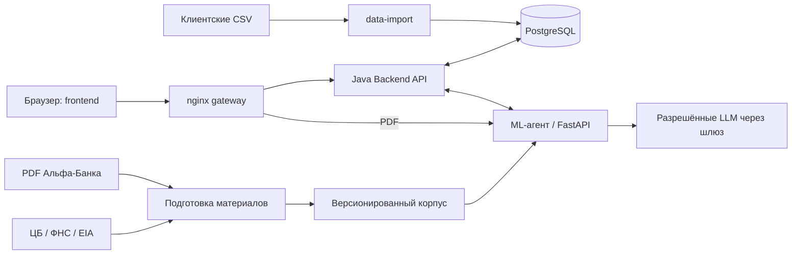

# Business Insights

## Обязательно выполнить перед финальной сдачей

Команда, подготовьте финальную сдачу по файлу **«КЕЙС_Альфа_Хак_Новостная_аналитика.pdf»**: формат сдачи — с. 8, постановка задачи и агентная логика — с. 6–7, критерии и ограничения — с. 9–14, разрешённые модели — с. 18.

- [ ] **Подготовить и загрузить на сайт соревнования документ со ссылкой на приватный репозиторий [AyKezBan/business-insights](https://github.com/AyKezBan/business-insights).** Указать в документе сдаваемую версию и точку входа в инструкцию проверки. Ссылка должна вести на репозиторий проекта.
- [ ] **Предоставить аккаунту жюри `alfa-hack-2026` доступ к приватному репозиторию** и проверить возможность чтения и клонирования.
- [ ] **Зафиксировать версию решения на момент дедлайна:** commit hash, тег или другой однозначный идентификатор. Сохранить историю коммитов и указать сдаваемую версию в документе и README. По кейсу коммиты после дедлайна не учитываются.
- [ ] **Проверить полноту описания решения внутри репозитория** по перечню ниже. Для каждого пункта дать ссылку на реализацию, инструкцию или результаты проверки; указать фактический статус и оставшиеся ограничения.

### Что должно быть описано внутри репозитория

| Требование кейса | Что описать и проверить |
| --- | --- |
| Назначение и бизнес-контекст | Целевой пользователь, решаемая задача, признаки компании и группы: отрасль, положение на рынке, доля рынка, виды деятельности, масштаб и бизнес-связи. Указать доступные данные, способ расчёта и ограничения недоступных показателей. |
| Данные и подготовка материалов | Обработка клиентских CSV, неполных, неоднозначных и зашумлённых данных; сбор внешних новостей и аналитики банка, классификация, извлечение ключевой информации, объединение и суммаризация материалов с сохранением первоисточников. |
| Персональный отбор и ранжирование | Какие признаки компании и роли влияют на выбор и порядок событий, как объясняется релевантность и как меняется лента для разных клиентов. |
| Содержание бизнес-инсайта | Что произошло, почему событие важно компании, возможные последствия, риски, возможности и обоснованные действия. Показать вклад аналитики Альфа-Банка и различие между подтверждёнными фактами, позицией банка, выводами AI и предположениями. |
| Собственная агентная логика | Планирование, работа с инструментами, общий контекст, самопроверка и адаптация при нехватке или противоречии данных. Обосновать выбранную схему одного или нескольких агентов. Описание текущей реализации: [ML-агент](ml-service/docs/insight-agent.md). |
| Интерфейс и проверяемый сценарий | Постоянная точка входа в сервис из интерфейса Альфа-Бизнеса; выбор клиента и роли, лента, карточка, уточняющий вопрос, другой разрез данных и переход к источнику. Дать пошаговую инструкцию взаимодействия с работающим прототипом. |
| Трассируемость и качество | Связь ключевых выводов с источниками, признаками компании и промежуточными шагами; результаты проверки на новых, ранее не показанных новостях. Описать метрики и регулярный мониторинг качества контента, персонализации и AI с учётом обратной связи пользователей и экспертов. |
| Безопасность и ограничения AI | Разграничение доступа, защита чувствительных данных, контроль и журналирование вызовов инструментов, ограничения небезопасных действий и место этих механизмов в архитектуре. Для прототипа кейс допускает обоснованное описание механизмов. |
| LLM и расход ресурсов | Фактически используемые модели из разрешённого списка приложения 3, их настройки и роль в решении; контроль общего дневного лимита ключа **500 руб.** и токенов. Описать собственную логику обработки, поиска, анализа, ранжирования и выводов. Кейс запрещает другие LLM, а также внешние AI-сервисы, автономных агентов и готовые мультиагентные системы в качестве основного компонента решения. |
| Архитектура и сопровождение | Компоненты, их взаимодействие, требования к окружению, конфигурации и переменные окружения; подход к масштабированию на новые отрасли, типы клиентов и источники и к дальнейшему сопровождению. |

### Обязательный комплект для самостоятельной проверки жюри

- [ ] Дополнить README назначением решения, архитектурой, описанием компонентов, требованиями к окружению, конфигурацией и пошаговым сценарием проверки.
- [ ] Проверить **единый воспроизводимый запуск через Docker** по [инструкции полного запуска](docs/materials-release-runbook.md). Зафиксировать версии языка и ключевых зависимостей lock-файлами или эквивалентным механизмом.
- [ ] Дополнить [THIRD_PARTY_NOTICES](THIRD_PARTY_NOTICES): сторонние компоненты, модели, датасеты, сервисы и смоделированные интеграции.
- [ ] Подготовить **синтетические тестовые данные** и, при необходимости, тестовые учётные записи для полного end-to-end-сценария. Описать подготовку и назначение данных; отдельно указать, какие проверки используют синтетические ответы, а какие — реальную модель.
- [ ] Повторить запуск и основной сценарий другим участником по общей инструкции. На демонстрации показать изменение ленты под клиента, содержимое карточки, источники и взаимодействие с работающим прототипом.
- [ ] Обновить [фактические результаты приёмки](docs/materials-acceptance.md) и закрыть обязательные проверки перед финальной отправкой. Сценарий проверки: [materials-e2e](docs/materials-e2e.md).

**Дополнительно по кейсу:** можно приложить архитектурную схему, описание API/OpenAPI, модель данных и тестовые сценарии. Заранее развернуть работающий прототип на бесплатном внешнем сервере рекомендуется; это отдельная рекомендация кейса.

## О проекте

Персонализированная новостная аналитика для руководителей крупного бизнеса — действующих клиентов Альфа-Банка. Проект объединяет внешние новости, банковскую аналитику и данные компании, чтобы объяснять влияние событий на её бизнес, риски, возможности и возможные действия.

Целевой сценарий: вход в раздел аналитики «Альфа-Бизнеса» → выбор компании и роли → лента инсайтов → карточка с источниками → уточняющий вопрос, обратная связь или обращение к менеджеру. Факты, позиция банка, выводы AI и гипотезы должны быть явно разделены; аналитика не является инвестиционной рекомендацией.

## Архитектура и структура

`CSV → data-import → PostgreSQL ↔ backend-api ↔ ml-service`.

Бэкенд собирает профиль компании и хранит операции и результаты в отдельной схеме БД. ML-сервис подготавливает корпус новостей и банковской аналитики, выполняет многошаговый анализ с поиском и самопроверкой, возвращает инсайты и ответы с источниками и трассами.

| Папка | Назначение и содержимое |
| --- | --- |
| [backend-api/](backend-api/) | Java 21 / Spring Boot: профиль компании, демонстрационный доступ, асинхронные операции анализа, API ленты, вопросов и обратной связи. |
| [contracts/](contracts/) | Общие JSON Schema обмена Backend ↔ ML, форматы материалов и пример профиля компании. |
| [data-import/](data-import/) | Python: проверка и нормализация трёх CSV, отчёт качества, атомарная загрузка в схему `business_insights` PostgreSQL. |
| [docs/](docs/) | Спецификация проекта, план работ и результаты приёмки материалов. |
| [frontend/](frontend/) | Интерфейс приложения в стиле UI Альфа Бизнеса. |
| [infra/](infra/) | Docker Compose для полного локального стека, подготовки корпуса и сквозных проверок. |
| [ml-service/](ml-service/) | Python / FastAPI: PDF/OCR, сбор новостей ЦБ/ФНС/EIA и импорт сохранённых статей, поиск по материалам, агентная логика, уточняющие вопросы и оценка качества. |

## Общий локальный запуск

Нужны Docker с Compose **2.24.4+**, Python 3 для команд `init`/`smoke` и исходные три CSV. Для полного сценария с проверенными PDF и сбором ЦБ/ФНС/EIA используйте [release-runbook](docs/materials-release-runbook.md): он включает bootstrap корпуса, refresh, каталог и явный запуск анализа. Базовый запуск без этого корпуса из корня репозитория:

```sh
./stack init
# В созданном .env задайте DATA_DIR — абсолютный путь к каталогу CSV.
# Для генерации реальной аналитики задайте LLM_API_KEY.
./stack up
```

Интерфейс: **http://127.0.0.1:8088**. Поднимаются PostgreSQL, импортёр, Java API, ML и frontend через nginx. Локальные пароли генерируются автоматически и остаются в игнорируемом `.env`. SQL-схема импорта создаётся импортёром; схема backend — Flyway. Повторный запуск не заменяет загруженный набор и сохраняет результаты.

```sh
./stack status
./stack logs backend
./stack down                 # Сохранить volumes и данные
./stack smoke                # Одноразовая проверка с синтетическими CSV и scripted ML
```

`smoke` не читает рабочий `.env`, не вызывает внешнюю модель, создаёт отдельный project со случайным именем и удаляет только его контейнеры/volumes. Это проверка интеграции, **не live-проверка качества LLM**.

UI использует Java API: компании, каталог материалов, сохранённые инсайты, вопросы, скрытие, обратная связь. Сразу после первого импорта лента пуста. После подготовки корпуса `materials-up` подключает его; каталог доступных материалов читается отдельно от ленты. Пользователь явно выбирает материал, компанию и роль для анализа. Сбор новостей и optional poller не запускают платную генерацию. Без materials overlay работает отдельный legacy JSONL-режим ML, который не подтверждает загрузку проверенного PDF-корпуса.

[Release-runbook](docs/materials-release-runbook.md) · [Инфраструктура и ограничения](infra/README.md) · [Сквозная проверка](docs/materials-e2e.md) · [Приёмка и исторические результаты](docs/materials-acceptance.md) · [Проверки базового стека](infra/VERIFICATION.md) · [Backend API](backend-api/README.md) · [ML](ml-service/README.md) · [Импорт](data-import/README.md)
**Персонализированная новостная аналитика для руководителей крупного бизнеса в учебном интерфейсе Альфа-Бизнеса.** Сервис связывает внешнее событие с данными конкретной компании и аналитикой Альфа-Банка, объясняет возможные последствия, риски и возможности, показывает основания и позволяет задать уточняющий вопрос.

Пользователь получает карточку с ответами на шесть вопросов: что произошло, почему это важно его компании, какие последствия возможны, какие действия обоснованы, как событие оценивает банк и на каких источниках основан вывод.

**Код и команды запуска находятся в ветке [develop](https://github.com/AyKezBan/business-insights/tree/develop).** Версия реализации, описанная в этом README: [`b83e5768acc2488ed05cf170183861b5f700cd94`](https://github.com/AyKezBan/business-insights/commit/b83e5768acc2488ed05cf170183861b5f700cd94). Это интегрированная версия с каталогом материалов, обновлением ленты и версиями событий. На главной странице `main` размещено описание решения; для запуска клонируется `develop`.

[12 критериев](#соответствие-12-критериям-кейса) · [Пользовательский сценарий](#пользовательский-сценарий) · [Запуск](#запуск-и-самостоятельная-проверка) · [Результаты проверок](#качество-метрики-и-результаты-проверок)

## Соответствие 12 критериям кейса

Нумерация соответствует разделу «Критерии успеха» на страницах 9–10 файла **«Альфа Хак_Новостная аналитика.pdf»**. Таблица описывает реализацию и фактические границы её проверки.

| № | Критерий | Реализация и подтверждение |
| --- | --- | --- |
| 01 | Бизнес-контекст клиента и значимые события | Java собирает профиль компании из CSV, продуктов, доступных связей группы, ФТС и платежей. `EventRelevance` сопоставляет темы события с признаками компании и ролью; причины релевантности сохраняются. [Правила профиля](https://github.com/AyKezBan/business-insights/blob/develop/backend-api/docs/profile-rules.md), [отбор и ранжирование](https://github.com/AyKezBan/business-insights/blob/develop/backend-api/docs/feed-refresh.md). Правила отбора объяснимые, их качество на размеченной выборке пока не откалибровано. |
| 02 | Содержательная интерпретация с учётом нескольких факторов | Агент объединяет событие, профиль, связанные материалы и банковские основания; формирует последствия, риски, возможности, сценарии и действия. Проверки удаляют неподтверждённые утверждения, а недостающие сведения отражаются явно. [Устройство агента](https://github.com/AyKezBan/business-insights/blob/develop/ml-service/docs/insight-agent.md). Смысловая приёмка полного набора ответов реальной модели ещё не завершена. |
| 03 | Аналитика Альфа-Банка и различие позиции банка и AI | Поиск BM25 использует проверенные фрагменты PDF с документом, страницей, датой и типом утверждения. Карточка разделяет банковскую оценку, опубликованный факт, вывод модели и гипотезу; отсутствие подходящей банковской аналитики отражается в результате. [Банковский корпус и проверка](https://github.com/AyKezBan/business-insights/blob/develop/ml-service/eval/BANK_REVIEW.md). |
| 04 | Обработка материалов, первоисточники и фактологическая точность | Реализованы сбор ЦБ/ФНС/EIA, PDF/OCR, классификация, извлечение фактов, объединение точных копий, версии исправлений и сохранение ссылок. Утверждения проверяются по источникам, цитатам, hashes и смыслу. [Подготовка материалов](https://github.com/AyKezBan/business-insights/blob/develop/ml-service/docs/material-ingestion.md). Семантические перефразы автоматически не объединяются; проверки снижают риск ошибки, но не подтверждают безошибочность всех live-ответов. |
| 05 | Качество на ранее не показанных новостях | Есть runner оценки, фиксируемые наборы событий и профилей, ручная рубрика и учёт всех попыток. Для контрольного выпуска зафиксированы 3 новых события × 3 профиля и минимум 9 QA. **Устойчивое качество живого прогона пока не подтверждено:** в сохранённом отчёте первые попытки завершились ошибками/таймаутом, полный набор не принят. [Фактическая приёмка, G09](https://github.com/AyKezBan/business-insights/blob/develop/docs/materials-acceptance.md), [рубрика](https://github.com/AyKezBan/business-insights/blob/develop/ml-service/eval/release-rubric-2026-10-26.json). |
| 06 | Полный пользовательский сценарий | UI связан с Java API: сессия, выбор компании и роли, каталог, явный запуск анализа, ожидание, карточка, источники, QA, оценка и скрытие. Полный маршрут и восстановление состояния проверены на синтетическом стенде с настоящими Java/ML/PostgreSQL/nginx. Полная браузерная приёмка реальных материалов остаётся частичной. [Сквозной сценарий](https://github.com/AyKezBan/business-insights/blob/develop/docs/materials-e2e.md). |
| 07 | Масштабирование и техническое сопровождение | Импорт, Java API, ML, UI и сбор материалов разделены на компоненты; контракты закреплены JSON Schema, новые издатели подключаются адаптерами, источники и результаты версионируются. Docker, миграции, тесты и диагностические отчёты описывают сопровождение. Текущий backend рассчитан на один экземпляр; горизонтальное масштабирование не заявляется. [Архитектура](https://github.com/AyKezBan/business-insights/blob/develop/backend-api/docs/architecture.md), [инфраструктура](https://github.com/AyKezBan/business-insights/blob/develop/infra/README.md). |
| 08 | Метрики и регулярный мониторинг качества с обратной связью | Runner считает ошибки, задержку и стоимость нового успешного инсайта; рубрика оценивает релевантность, факты, глубину, основания и полезность действий. Оценки пользователя, открытия и скрытия сохраняются в PostgreSQL. Описанный ниже цикл повторной оценки использует версии источников и регрессионные примеры. Отдельный постоянно работающий сервис мониторинга качества не развёрнут. [Runner](https://github.com/AyKezBan/business-insights/blob/develop/ml-service/src/insight_agent/evaluation.py), [правила оценки](https://github.com/AyKezBan/business-insights/blob/develop/ml-service/eval/release-rubric-2026-10-26.json). |
| 09 | Заметная и постоянно доступная точка входа | В учебной оболочке Альфа-Бизнеса доступны боковая навигация и главная «Обзор бизнеса» с переходами к бизнес-событиям и выбору материала для анализа. [Интерфейс](https://github.com/AyKezBan/business-insights/blob/develop/frontend/README.md). Интеграция в настоящий интернет-банк смоделирована. |
| 10 | Взаимодействие с подготовленной аналитикой | В карточке есть последствия, риски и рекомендации, источники с PDF-страницами и уточняющие вопросы. Обратная связь и скрытие сохраняются сервером, готовые результаты можно повторно открыть. QA использует контекст и версию источников родительского анализа. [UI](https://github.com/AyKezBan/business-insights/blob/develop/frontend/README.md), [API](https://github.com/AyKezBan/business-insights/blob/develop/backend-api/src/main/resources/static/openapi.yaml). |
| 11 | Агентная логика, инструменты и адаптация | Собственный оркестратор выполняет разбор события, план, поиск, персонализацию, проверку и корректировку. При недостатке банковского покрытия расширяется поиск; при ошибках корректируется черновик или исключается непроверенный текст. Логические роли обмениваются структурированными данными. [Агентная схема](https://github.com/AyKezBan/business-insights/blob/develop/ml-service/docs/insight-agent.md). |
| 12 | Трассируемость AI и происхождения выводов | Сохраняются `run_id`, `claim_id`, ссылки и hashes источников, номера страниц, границы цитат, признаки профиля, версии корпуса/события, промежуточные шаги, модели, расход и результаты проверок. Java сохраняет входы до постановки в очередь; старые QA закреплены за исходной revision. [Контракты](https://github.com/AyKezBan/business-insights/blob/develop/contracts/README.md), [трассы и воспроизводимость](https://github.com/AyKezBan/business-insights/blob/develop/docs/materials-e2e.md). |

## Пользовательский сценарий

1. Открыть приложение и перейти в профиль. Сервер возвращает компании, доступные демонстрационному пользователю по связям ФЛ–ЮЛ; пользователь выбирает компанию и аналитическую роль.
2. Открыть каталог материалов. Каталог исходных новостей отделён от ленты готовых инсайтов.
3. Выбрать материал и запустить анализ для своей компании и роли. Интерфейс отслеживает асинхронную операцию.
4. Прочитать карточку: событие, связь с компанией, последствия, риски, возможности, действия, позицию банка и ограничения данных.
5. Открыть оригинальную статью или банковский PDF на указанной физической странице, сопоставить утверждение с основанием.
6. Задать уточняющий вопрос либо перейти к другому разделу карточки. При нехватке оснований система возвращает явное ограничение или отсутствие ответа.
7. Оценить полезность, скрыть карточку или зарегистрировать следующий шаг. Состояние сохраняется на сервере; обращение к менеджеру фиксируется как локальное намерение без доставки в CRM.

Чтение каталога и ленты не вызывает LLM. Генерация запускается явным действием пользователя. После первого CSV-импорта лента пуста; для анализа нужны опубликованный корпус и настроенный доступ к модели.

## Архитектура и компоненты



Gateway передаёт в ML только запросы чтения оригинальных документов; запросы генерации, QA и трасс проходят через Java API. Профиль, права демонстрационной сессии, очередь, лента и пользовательское состояние обслуживаются backend. Импорт хранится в схеме `business_insights`, операции и результаты API — в отдельной схеме `backend_api`.

| Компонент | Технологии | Назначение |
| --- | --- | --- |
| [data-import](https://github.com/AyKezBan/business-insights/blob/develop/data-import/README.md) | Python, psycopg, PostgreSQL COPY | Проверка трёх CSV, нормализация, отчёт качества и атомарная загрузка снимка. |
| [backend-api](https://github.com/AyKezBan/business-insights/blob/develop/backend-api/README.md) | Java 21, Spring Boot 3.5.7, Maven, JDBC, Flyway | Профиль, доступ к компаниям, каталог, очередь анализа, версии событий, лента, QA и обратная связь. |
| [ml-service](https://github.com/AyKezBan/business-insights/blob/develop/ml-service/README.md) | Python 3.12 в образе, FastAPI, Pydantic, HTTPX | Подготовка материалов, поиск, агентный анализ, смысловая проверка, QA и трассы. |
| [frontend](https://github.com/AyKezBan/business-insights/blob/develop/frontend/README.md) | HTML, CSS, JavaScript | Учебный интерфейс Альфа-Бизнеса, работающий с Java API через один origin. |
| [infra](https://github.com/AyKezBan/business-insights/blob/develop/infra/README.md) | Docker Compose, PostgreSQL 17, nginx | Общий запуск, порядок готовности сервисов, постоянные volumes и gateway. |
| [contracts](https://github.com/AyKezBan/business-insights/blob/develop/contracts/README.md) | JSON Schema, OpenAPI | Типизированный обмен ML ↔ Java и публичный API. |

Python-зависимости ML закреплены в [requirements.lock](https://github.com/AyKezBan/business-insights/blob/develop/ml-service/requirements.lock), Java-версия и зависимости — в [pom.xml](https://github.com/AyKezBan/business-insights/blob/develop/backend-api/pom.xml). OCR выполняют Poppler и Tesseract `rus+eng`; фактические версии инструментов записываются при подготовке корпуса. Сторонние компоненты, источники, модели и синтетические интеграции описаны в [THIRD_PARTY_NOTICES](https://github.com/AyKezBan/business-insights/blob/develop/THIRD_PARTY_NOTICES) и [уведомлениях frontend](https://github.com/AyKezBan/business-insights/blob/develop/frontend/THIRD_PARTY_NOTICES.md).

## Данные и персонализация

| Вход | Использование |
| --- | --- |
| `df_Uid_data_hack.csv` | Компания, ОКВЭД, выручка, продукты, численность, возраст, форма собственности, география, группа и сведения ФТС. |
| `df_Fid_Uid_link_hack.csv` | Доступные связи физического лица с компаниями и исходные сведения географии связи. |
| `df_Uid_payment_hack.csv` | Наблюдаемые платёжные потоки, контрагенты, доли направлений и переводы между своими счетами. |
| Девять PDF кейса | Банковские опубликованные факты, оценки и прогнозы с проверяемым происхождением. |
| Внешние публикации | Тексты и метаданные ЦБ, ФНС и EIA; связанные официальные данные ЦБ по ставке и валютным курсам. |

Импорт сохраняет реальные нули, различает неизвестное и `false`, отмечает неоднозначные ID и исключает непригодные записи из ML-агрегатов. Выручка относится к 2025 году; значение ровно `1000` обрабатывается как заглушка. В расчётах денег используются Decimal/BigDecimal.

Профиль содержит происхождение и ограничения данных. Страны ФТС не устанавливают направление торговли, платежи не доказывают отношения покупателя и поставщика, география регистрации отделена от географии связи. Сумма доступных выручек участников группы не выдаётся за консолидированную выручку. Доля рынка не рассчитывается без данных об объёме рынка. Подробные формулы и границы — в [правилах профиля](https://github.com/AyKezBan/business-insights/blob/develop/backend-api/docs/profile-rules.md).

Отбор событий реализован объяснимыми правилами: совпадение каналов влияния с ОКВЭД, продуктами, ФТС и контрагентами, признаками роли и географией. Готовая лента сортируется по релевантности, затем влиянию, времени и ID. Устаревшие версии и события вне окна актуальности исключаются. [Правила refresh и версий](https://github.com/AyKezBan/business-insights/blob/develop/backend-api/docs/feed-refresh.md) описывают баллы, пороги, повторы и пределы очереди.

## Материалы банка и внешние источники

Банковский pipeline извлекает текст постранично, распознаёт сканы через OCR и формирует фрагменты с ID документа, страницей, темой, смещениями и hash. Публикуются фрагменты, прошедшие проверку по оригиналу. Прогноз хранит свой горизонт и срок действия; исправления OCR и публикаций создают новые неизменяемые версии.

В зафиксированном [отчёте подготовки корпуса](https://github.com/AyKezBan/business-insights/blob/develop/docs/materials-acceptance.md) описаны 9 PDF, 64 просмотренные страницы и 72 проверенных фрагмента. На 26.10.2026 требованиям актуальности соответствовал 61 фрагмент из 7 датированных документов. Эти результаты относятся к указанному в отчёте корпусу; исходные PDF/OCR и опубликованный store хранятся отдельно от Git.

Внешние материалы собираются из трёх согласованных издателей: ЦБ (`cbr_press`), ФНС (`fns_news`), EIA (`eia_today`). Сохраняются исходный URL, дата и её точность, издатель, язык, текстовые hashes и история. Публикации EIA сохраняют исходную географию и авторство; они не считаются позицией Альфа-Банка. Точные копии объединяются, конфликтующие сведения остаются явно отмеченными.

Результат анализа закреплён за revision корпуса и версией события. Обновление корпуса не меняет источники уже принятого анализа. Старые вопросы и ссылки PDF обращаются к исходной версии. Описания CLI и восстановления проверенного корпуса: [material-ingestion](https://github.com/AyKezBan/business-insights/blob/develop/ml-service/docs/material-ingestion.md), [BANK_REVIEW](https://github.com/AyKezBan/business-insights/blob/develop/ml-service/eval/BANK_REVIEW.md).

## Как работает AI-компонент

Агентная логика реализована собственным Python-оркестратором. Поиск, арифметика, управление версиями, валидация и переходы между шагами выполняются кодом; модели возвращают структурированные ответы по схемам.

| Логическая роль | Работа внутри одного анализа |
| --- | --- |
| `analyst` | Выделяет факты, участников и каналы влияния события; общий разбор кешируется с учётом содержимого и версий. |
| `planner` | Планирует необходимые источники и инструменты; предусмотрен ограниченный план по правилам при сбое. |
| `researcher` | Вызывает поиск банковских фрагментов, связанных новостей и официальных данных; при нехватке покрытия расширяет поиск. Это детерминированный шаг. |
| `personalizer` | Связывает материалы с профилем компании и ролью, формирует последствия, риски, возможности, сценарии и действия. |
| `verifier` | Проверяет ссылки, признаки, числа, цитаты и смысл итоговых утверждений. Ошибки приводят к корректировке или исключению непроверенного текста. |
| `qa` | Отвечает на вопрос по сохранённой карточке, профилю и закреплённой версии источников. |

Проверки, число итераций, вызовы инструментов, время и расход ограничены настройками. При отсутствии достаточного основания результат может быть ограниченным, отказом или отсутствием ответа; техническая ошибка сохраняется отдельно. Смысловая проверка модели является дополнительным механизмом контроля, а качество живого выпуска оценивается по независимой рубрике.

Разрешённый список моделей соответствует приложению 3 кейса: **Gemma 4 26B A4B, GLM-5.3-Flash, Qwen3.6 35B A3B, DeepSeek-V4.1-Flash, Qwen3-VL-30B-A3B-Instruct, Kimi-K2.6**. В базовом Compose три настройки `LLM_MODEL_*` по умолчанию указывают на `google/gemma-4-26b-a4b-it`; конкретные роли и доступные им модели задаются конфигурацией шлюза.

Для рублёвого бюджета есть сохраняемый ledger, пороги экономии и контроль вызовов. Общий лимит ключа по кейсу — 500 руб. в день. Локальный учёт видит расходы этой установки; остаток общего ключа и тарифы провайдера требуют отдельной сверки. Дневной счётчик токенов остаётся в памяти, а резервирование между несколькими процессами имеет ограничения.

## Запуск и самостоятельная проверка

### Окружение

Нужны Git, работающий Docker с Compose **2.24.4+**, Python 3 для `stack init`/`stack smoke` и доступ к реестрам образов, Maven и PyPI при первой сборке. Контейнеры устанавливают JDK/Maven, Python, PostgreSQL и OCR-зависимости. Команды `./stack` выполняются в Linux/macOS или Linux-окружении WSL2 с Docker Desktop. Нативный Windows-запуск ML/CLI ограничен использованием `fcntl`; поддерживаемый путь этих компонентов — Linux-контейнер.

```sh
git clone --branch develop https://github.com/AyKezBan/business-insights.git
cd business-insights
git rev-parse HEAD
```

Для приватного репозитория требуется предоставленный владельцем доступ. Проверяющий аккаунт жюри, указанный в кейсе: `alfa-hack-2026`.

### Проверка интеграции без ключа и закрытых данных

```sh
./stack smoke
```

Команда создаёт отдельный Compose project, синтетические CSV и материалы, запускает настоящие PostgreSQL, импорт, Java, ML-оркестратор и nginx. Ответы LLM в этом режиме явно scripted. Проверяются операции, повторы, QA, источники, пользовательское состояние и восстановление. Рабочий `.env` не читается, внешняя модель не вызывается. Отчёт сохраняется в `.local/smoke-*/report.json`; временные контейнеры и volumes этого прогона удаляются. Smoke является автоматической проверкой интеграции, а не постоянно открытой демонстрацией и не оценкой качества реальной LLM.

### Базовый серверный режим

```sh
./stack init
# Заполнить созданный .env по таблице ниже.
./stack config
./stack up
./stack status
```

Интерфейс: **[http://127.0.0.1:8088](http://127.0.0.1:8088)**.

`init` генерирует локальные пароль БД и bearer и сохраняет существующую конфигурацию при повторном вызове. Базовый режим импортирует CSV и открывает интерфейс, компании и профили. Каталог проверенных материалов и полная генерация используют режим корпуса из следующего подраздела.

| Настройка в `.env` | Значение и назначение |
| --- | --- |
| `DATA_DIR` | Абсолютный существующий каталог с тремя CSV из таблицы входов. |
| `BACKEND_DEMO_PERSON_ID` | ID физлица из файла связей, имеющего доступные компании. Значение по умолчанию `F_1` необходимо сверить с набором. |
| `WEB_PORT` | Локальный порт интерфейса, по умолчанию `8088`. |
| `POSTGRES_PASSWORD`, `BACKEND_DEMO_TOKEN` | Случайные локальные значения, создаваемые `stack init`. |
| `LLM_BASE_URL`, `LLM_API_KEY` | Рабочий адрес совместимого шлюза и ключ для реальной генерации. Пустой ключ не включает подмену ответов. |
| `LLM_MODEL_LIGHT`, `LLM_MODEL_REASONING`, `LLM_MODEL_FALLBACK` | Фактически доступные разрешённые модели для соответствующих шагов. |
| `MATERIALS_STORE` | Существующий каталог опубликованного проверенного корпуса. |
| `PDF_DIR`, `MATERIALS_REVIEW_DIR` | Каталоги оригинальных PDF и проверенных review/corrections для подготовки корпуса. |
| `MATERIALS_PUBLIC_BASE_URL` | Адрес открытия документов из браузера; при пустом значении используется `http://127.0.0.1:WEB_PORT`. |
| `FEED_MAX_AGE` | Окно актуальности событий, по умолчанию `30d`. |
| `LLM_TIMEOUT_SECONDS`, `AGENT_MAX_SECONDS`, `ML_REQUEST_TIMEOUT` | Ограничения ожидания модели, анализа и backend; базовые значения — 60, 120 и 180 секунд. |

Полный шаблон: [.env.example](https://github.com/AyKezBan/business-insights/blob/develop/.env.example). CSV, PDF, полные статьи, OCR, trace и ключи хранятся вне Git; в репозитории есть код, схемы, синтетические fixtures и проверяемые metadata.

### Полный режим с банковским корпусом и новостями

Подготовка store воспроизводится по [release-runbook](https://github.com/AyKezBan/business-insights/blob/develop/docs/materials-release-runbook.md): публикация проверенных PDF-фрагментов или восстановление точного ранее проверенного корпуса, sync издателей и проверка целостности. Новый OCR требует сверки с оригиналом; один review-файл без совпадающих hashes не заменяет подготовленный корпус.

После настройки существующих каталогов в `.env` и подготовки банковского store:

```sh
GIT_SHA="$(git rev-parse HEAD)" docker compose -f compose.yaml -f infra/compose.materials.yaml --profile jobs build materials
./stack materials sync --store /app/materials --sources cbr_press,fns_news,eia_today --limit-per-source 5
./stack materials check --store /app/materials
./stack materials-up
./stack status
```

В полном режиме `GET /api/v1/materials/events` возвращает каталог материалов через gateway, а оригинальные PDF открываются по `/v1/materials/documents/...` с закреплённой revision и `#page=N`.

Повторный сбор можно включить командой `./stack materials-watch`: optional poller выполняет sync трёх издателей, по умолчанию через 900 секунд после предыдущего цикла, с backoff и отчётом ошибок. Сбор не вызывает LLM и не запускает массовый анализ компаний. Runtime подхватывает нормально опубликованную ревизию без рестарта.

```sh
./stack logs backend
./stack logs ml
./stack down
```

Обычная остановка сохраняет volumes и данные. Для последующих запусков окружения с корпусом используется `materials-up`. Точные команды bootstrap, диагностики и восстановления находятся в [runbook](https://github.com/AyKezBan/business-insights/blob/develop/docs/materials-release-runbook.md).

## API и воспроизводимость результатов

| Маршрут Java | Назначение |
| --- | --- |
| `GET /api/v1/session`, `GET /api/v1/companies` | Демонстрационная сессия и доступные компании. |
| `GET /api/v1/companies/{id}/profile` | Профиль, ограничения и происхождение данных. |
| `GET /api/v1/materials/events` | Синхронизация и чтение каталога опубликованных материалов. |
| `POST /api/v1/analyses` | Явный анализ выбранного события, компании и роли. |
| `POST /api/v1/companies/{id}/insights/refresh` | Отбор материалов из каталога и постановка ограниченного числа анализов в очередь. |
| `GET /api/v1/operations/{id}` | Опрос состояния асинхронной операции. |
| `GET /api/v1/companies/{id}/insights` | Лента готовых карточек. |
| `POST /api/v1/insights/{id}/questions` | Уточняющий вопрос по карточке. |
| `GET /api/v1/insights/{id}/trace` | Существенные шаги, источники и результаты проверки. |
| `/opened`, `/state`, `/feedback`, `/actions` у карточки | Открытие, скрытие, оценка и следующий шаг. |

Полный контракт: [OpenAPI](https://github.com/AyKezBan/business-insights/blob/develop/backend-api/src/main/resources/static/openapi.yaml), [схемы ML](https://github.com/AyKezBan/business-insights/blob/develop/contracts/ml/). Анализ и QA возвращают `202`, `Location` и `Retry-After`; `Idempotency-Key` защищает одинаковый запрос от повторного запуска. Refresh имеет отдельный batch-ответ с результатами отбора и ID операций.

Профиль, роль, событие, cutoff, revision корпуса и hashes сохраняются до очереди. Исправления создают версии события; старые операции и карточки помечаются устаревшими. Сохранённые оригиналы и snapshots позволяют восстановить основания старого анализа. Если нужная версия недоступна, QA возвращает контролируемое отсутствие ответа.

## Качество, метрики и результаты проверок

Автоматический runner [evaluation.py](https://github.com/AyKezBan/business-insights/blob/develop/ml-service/src/insight_agent/evaluation.py) сохраняет результаты с версиями, исходами и расходом. M7 включает долю технических ошибок и p95/max задержки, M8 — суммарную стоимость и стоимость нового успешного инсайта. Содержательные оценки релевантности, фактов, глубины, доказательств и полезности действий заполняются по ручной рубрике. [Release rubric v2](https://github.com/AyKezBan/business-insights/blob/develop/ml-service/eval/release-rubric-2026-10-26.json) фиксирует новые события до генерации, недопустимые ошибки, проверку каждого поля и QA.

Процесс регулярного контроля состоит из повторяемого offline CI, оценки на замороженном наборе новых событий и разбора пользовательских оценок вместе с экспертом. Выявленные дефекты сохраняются как регрессии; новая проверка той же ошибки использует новый заранее зафиксированный пример. Feedback привязан к карточке и версии анализа. Постоянный отдельный сервис алертов качества в текущий прототип не входит.

| Проверка | Зафиксированный результат и область применимости |
| --- | --- |
| Интеграционный baseline `9e54025` | В отчёте выпуска: ML — 928 passed, Java/PostgreSQL 17 — 131 passed, импорт — 7 passed, UI — 20 Python tests и 6 Node suites, без skips. Это результаты указанного baseline. |
| Корпус банка и поиск | 64 page dispositions, 72 verified-фрагмента; gold-наборы поиска 10/10 и 12/12, near-negative отказы 6/6. |
| Сквозной синтетический стенд | Настоящие Java/Uvicorn/PostgreSQL/nginx; 29 gateway assertions, 12 исторических assertions, отрицательные HTTP-сценарии, браузерный анализ, QA, источники, feedback и рестарт. Внешняя LLM не вызывалась. |
| Дополнительный локальный запуск кода `b83e576` | UI, session, компании, профиль, лента и ML health отвечали HTTP 200. Java package собран: 138 тестов, 0 failures/errors, 40 DB-зависимых тестов пропущены без отдельной тестовой БД. На этом стенде ключ и корпус не были подключены; live-анализ не проверялся. |
| Реальные материалы в браузере, G08 | Частичная приёмка. Оригинальный PDF получен с правильным hash; визуальная приёмка реального PDF и полного набора реальных карточек не закрыта. |
| Новые события и реальная LLM, G09 | Полный прогон 9 анализов + минимум 9 QA не принят: сохранены неуспешные попытки с timeout/ошибками схемы. Успешная короткая проверка связи с моделью не является приёмкой содержания. |
| Воспроизведение вторым участником, G10 | В итоговом отчёте не подтверждено. |

Основной источник результатов и их SHA: [materials-acceptance.md](https://github.com/AyKezBan/business-insights/blob/develop/docs/materials-acceptance.md). Дополнительная проверка обновления ленты: [PR9 integration verification](https://github.com/AyKezBan/business-insights/blob/develop/backend-api/docs/pr9-integration-verification.md). Самостоятельные команды, требования к выделенной тестовой PostgreSQL и ожидаемые инварианты приведены в [materials-e2e.md](https://github.com/AyKezBan/business-insights/blob/develop/docs/materials-e2e.md) и [offline CI](https://github.com/AyKezBan/business-insights/blob/develop/infra/ci/README.md). Успешный Maven без DB-тестов не подтверждает проверки хранения.

## Безопасность и границы прототипа

Общий Compose публикует только gateway на `127.0.0.1`; PostgreSQL и служебный ML API остаются во внутренней сети. Java проверяет bearer и доступ к компании, gateway отклоняет посторонний Origin, секрет модели не попадает в браузер. Вызовы инструментов ограничены схемами аргументов и разрешёнными источниками, а источник рассматривается как недоверенные данные. Входы, обращения к инструментам и результаты проверки отражаются в трассе.

Авторизация Альфа-Бизнеса смоделирована: связь ФЛ–ЮЛ определяет демонстрационный список компаний, роль выбирается явно и не подтверждает полномочия. Подключения к настоящему интернет-банку, CRM и платёжным действиям нет. Безопасность многопользовательского банковского внедрения, TLS, отдельные сервисные credentials и политика хранения диагностических данных требуют отдельной реализации.

Текущий backend работает с одной локальной очередью. После рестарта незавершённые операции становятся `FAILED`; автоматический платный повтор не выполняется. Контекст QA и рублёвый ledger сохраняются в trace volume, исторические источники — в store. Токенный счётчик и некоторые кеши остаются в памяти; общий бюджет нескольких процессов и других участников по ключу не контролируется одной установкой.

Релевантность задаётся начальными правилами. Поле структурированного сравнения `model_vs_bank` остаётся пустым. Оценка влияния копируется из проверяемого черновика и требует дополнительной сверки после удаления отдельных утверждений. Часть признаков, достаточных для профиля Java, пока не преобразуется в самостоятельные ML-сигналы. Эти ограничения учитываются при оценке полезности результата.

`as_of` задаёт cutoff даты публикации, а не полноценную историческую картину знаний рынка. Доля рынка и консолидированная выручка не выводятся из неполных данных. Технические тесты и наличие смыслового verifier не заменяют независимую оценку фактической точности и бизнес-полезности.

## Расширение и сопровождение

Новые источники добавляются через адаптеры и согласованный registry; новые темы и отрасли — через классификацию, каналы влияния и наборы проверки. Форматы профиля и ответа меняются через версионируемые схемы и проверку соответствия Java/ML. Контейнеры, Flyway, immutable snapshots, trace и тестовые отчёты составляют основу сопровождения. Горизонтальное масштабирование требует общего хранилища заданий, согласованного кеша и бюджета; в текущем выпуске оно не реализовано.

## Навигация по репозиторию

| Материал | Содержимое |
| --- | --- |
| [Release-runbook](https://github.com/AyKezBan/business-insights/blob/develop/docs/materials-release-runbook.md) | Подготовка входов, bootstrap/rebuild корпуса, полный запуск, sync, проверка источников, диагностика и остановка. |
| [Архитектура API](https://github.com/AyKezBan/business-insights/blob/develop/backend-api/docs/architecture.md) | Компоненты, хранение и схемы взаимодействия. |
| [Правила данных](https://github.com/AyKezBan/business-insights/blob/develop/data-import/docs/DATA_RULES.md), [схема БД](https://github.com/AyKezBan/business-insights/blob/develop/data-import/docs/SCHEMA.md) | Нормализация, качество, таблицы и происхождение данных. |
| [Агент](https://github.com/AyKezBan/business-insights/blob/develop/ml-service/docs/insight-agent.md), [подготовка материалов](https://github.com/AyKezBan/business-insights/blob/develop/ml-service/docs/material-ingestion.md) | Логика AI, инструменты, OCR, поиск, review и версии. |
| [Контракты](https://github.com/AyKezBan/business-insights/blob/develop/contracts/README.md), [OpenAPI](https://github.com/AyKezBan/business-insights/blob/develop/backend-api/src/main/resources/static/openapi.yaml) | Форматы обмена и публичные маршруты. |
| [Проверки](https://github.com/AyKezBan/business-insights/blob/develop/docs/materials-e2e.md), [фактическая приёмка](https://github.com/AyKezBan/business-insights/blob/develop/docs/materials-acceptance.md) | Сценарии, версии, результаты и незакрытые проверки. |
| [Синтетические профили](https://github.com/AyKezBan/business-insights/blob/develop/ml-service/eval/release-profiles-2026-10-26.json), [smoke fixtures](https://github.com/AyKezBan/business-insights/blob/develop/infra/smoke/prepare.py) | Воспроизводимые тестовые входы без клиентских CSV и банковских оригиналов. |
| [THIRD_PARTY_NOTICES](https://github.com/AyKezBan/business-insights/blob/develop/THIRD_PARTY_NOTICES) | Сторонние компоненты, внешние источники, модели, данные и смоделированные части. |
