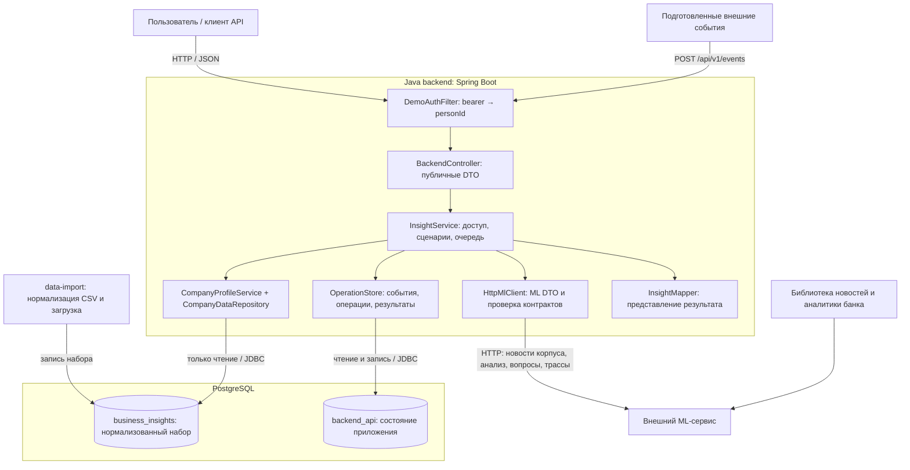
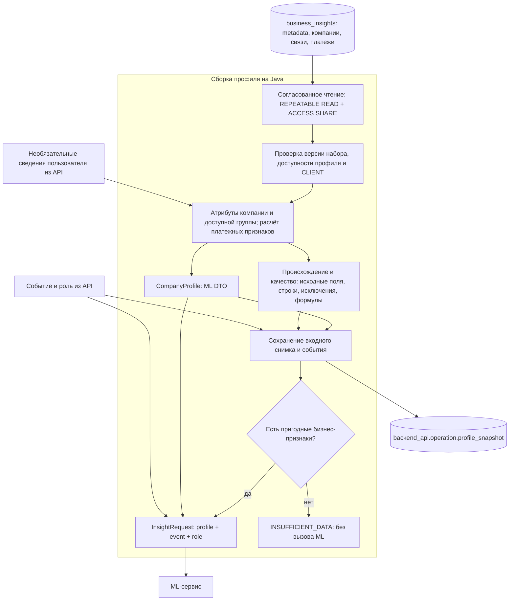
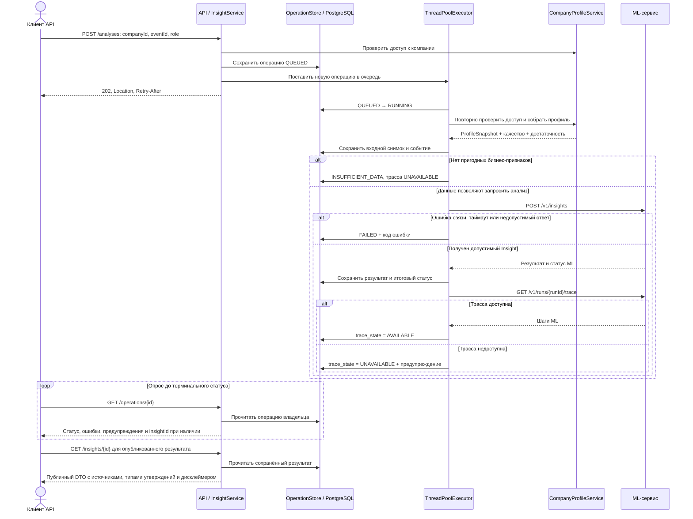
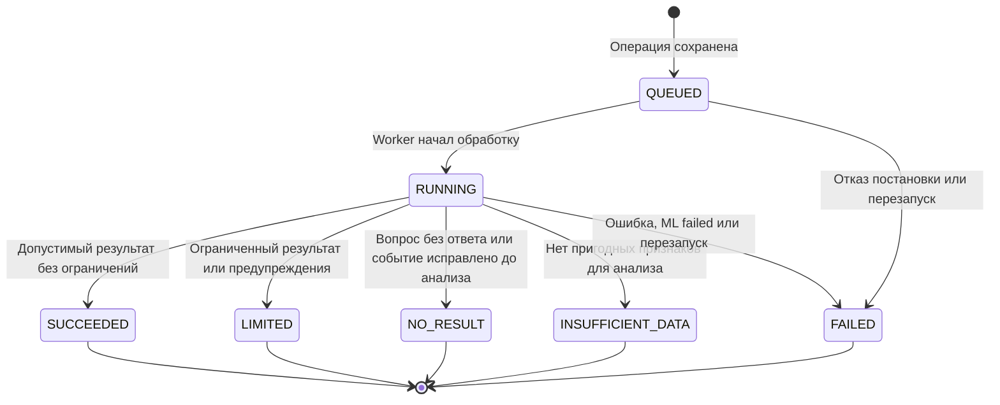
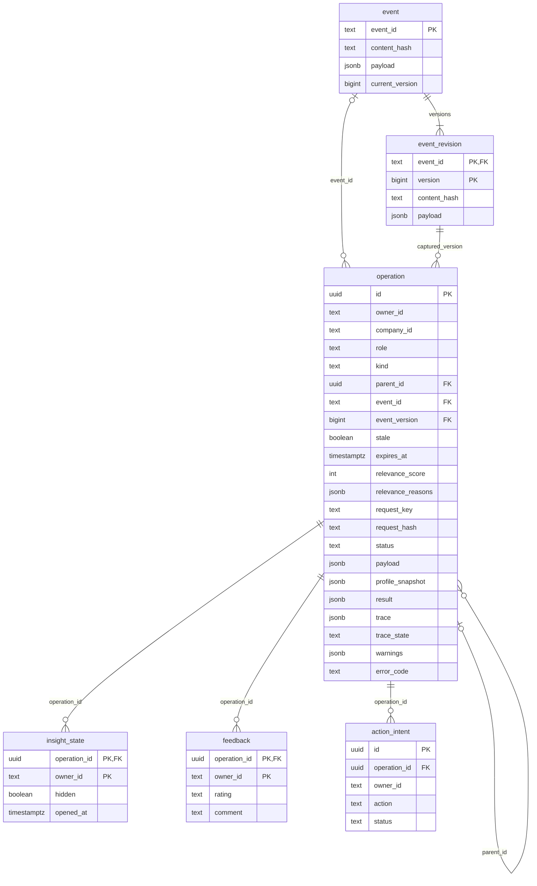

# Архитектура бэкенда

Диаграммы описывают текущую реализацию Java-бэкенда. Форматы запросов и ответов — в [OpenAPI](../src/main/resources/static/openapi.yaml), запуск — в [README](../README.md).

## 1. Компоненты и границы ответственности

Java отвечает за чтение БД, расчёт признаков, сборку профиля и сериализацию ML-запроса. Flyway управляет только схемой `backend_api`. Сбор внешних новостей и наполнение банковской библиотеки находятся за границей этого сервиса. Java принимает готовые события и читает загруженный корпус ML при явном обновлении ленты, выполняет отбор и ставит анализ в очередь. [Правила процесса и версий](feed-refresh.md).

Bearer моделирует авторизованного пользователя. Проверка связи ФЛ–ЮЛ и владельца операции ограничивает доступ, но не удостоверяет реальные полномочия. Роль поступает явно в запросе; источники входного события маркируются как внешние новости, а не как аналитика банка.

## 2. PostgreSQL → CompanyProfile → ML

Блокировки берутся до чтения таблиц и удерживаются только на время сборки профиля, без ожидания ML. Они защищают чтение от замены набора импортёром через `TRUNCATE`.

ML DTO и диагностический снимок разделены: неизвестные значения остаются неизвестными, оба источника численности и исключённые платежи сохраняются. Частичная сумма выручек не становится консолидированной, а платежи и страны ФТС не устанавливают коммерческие отношения или направления торговли. Формулы и знаменатели — в [правилах профиля](profile-rules.md).

## 3. Асинхронный анализ

Событие предварительно регистрируется через `POST /api/v1/events`. Повтор `eventId` с другим содержимым отклоняется.

Результат сохраняется до получения трассы: её недоступность не удаляет инсайт. `Idempotency-Key` с тем же входом возвращает существующую операцию без нового ML-вызова; другой вход с тем же ключом даёт `409`. Переполненная очередь отклоняет новый запрос либо переводит уже созданную операцию в `FAILED/QUEUE_FULL` при отказе постановки.

Вопрос создаёт отдельную операцию `QUESTION` со ссылкой на исходный анализ. Используются сохранённый профиль и ML-идентификатор инсайта; ответ и собственная трасса вопроса сохраняются отдельно. Если контекст в памяти ML утрачен, операция завершается `ML_CONTEXT_EXPIRED`. Трассы обоих видов операций доступны через `GET /operations/{id}/trace`.

## 4. Состояния операций

`NO_RESULT` соответствует ответу ML `no_answer` или прекращению устаревшего анализа до вызова ML. `INSUFFICIENT_DATA` означает недостаточный профиль без вызова ML. Лента публикует только актуальные, непросроченные анализы `SUCCEEDED` и `LIMITED`, по одной последней карточке на событие. Сортировка идёт по релевантности, влиянию и времени создания. Состояние трассы (`PENDING`, `AVAILABLE`, `UNAVAILABLE`) хранится независимо от результата.

Очередь находится в памяти одного экземпляра backend: по умолчанию два worker-потока и 16 мест ожидания. После перезапуска незавершённые операции становятся `FAILED/BACKEND_RESTARTED`. Автоматического повторного ML-вызова нет; при таймауте завершение внешней операции неизвестно.

## 5. Хранение состояния приложения

Основные связи и поля схемы `backend_api`:

Уникальность `(owner_id, kind, request_key)` обеспечивает идемпотентность операций. Внешние ключи на таблицы импортированного набора не создаются: сохраняются идентификаторы и снимок использованных данных. `action_intent` фиксирует намерение локально, без отправки менеджеру или в CRM.

Исходные ограничения ML и правила проверки ответов описаны в [совместимости ML](ml-compatibility.md).
