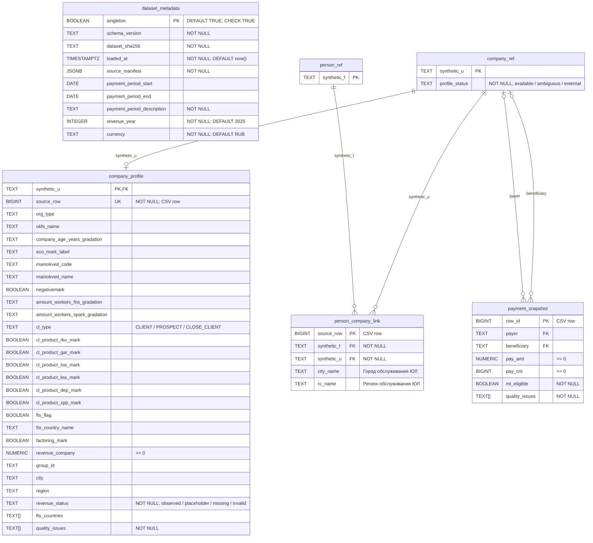

# Схема БД

Схема `business_insights`, один текущий набор. Источник: [таблицы](../sql/02_tables.sql), [индексы](../sql/03_indexes.sql).

## Mermaid-диаграмма

`PK` — первичный ключ, `FK` — внешний ключ, `UK` — уникальность. Первичные ключи обязательны.

## Поля таблиц

В столбце «NULL» указана допустимость неизвестного значения. Денежные NUMERIC хранятся без фиксированной шкалы.

### dataset_metadata

| Поле | Тип | NULL | Назначение / ключ |
| --- | --- | --- | --- |
| `singleton` | `BOOLEAN` | нет | Единственная запись метаданных; значение TRUE; PK |
| `schema_version` | `TEXT` | нет | Версия структуры и нормализации |
| `dataset_sha256` | `TEXT` | нет | SHA-256 набора исходных файлов |
| `loaded_at` | `TIMESTAMPTZ` | нет | Время загрузки; по умолчанию now() |
| `source_manifest` | `JSONB` | нет | Хеши файлов, отчёт качества и номера карантинных записей |
| `payment_period_start` | `DATE` | да | Начало периода; неизвестно |
| `payment_period_end` | `DATE` | да | Конец периода; неизвестен |
| `payment_period_description` | `TEXT` | нет | Известное описание периода: «с 1 января» |
| `revenue_year` | `INTEGER` | нет | Отчётный год выручки; по умолчанию 2025 |
| `currency` | `TEXT` | нет | Валюта; по умолчанию RUB |

### company_ref

| Поле | Тип | NULL | Назначение / ключ |
| --- | --- | --- | --- |
| `synthetic_u` | `TEXT` | нет | ID компании; PK |
| `profile_status` | `TEXT` | нет | available / ambiguous / external |

### company_profile

| Поле | Тип | NULL | Назначение / ключ |
| --- | --- | --- | --- |
| `synthetic_u` | `TEXT` | нет | ID компании; PK, FK → company_ref.synthetic_u |
| `source_row` | `BIGINT` | нет | Логический номер записи исходного CSV без заголовка; UK |
| `org_type` | `TEXT` | да | Тип организации |
| `okfs_name` | `TEXT` | да | Форма собственности |
| `company_age_years_gradation` | `TEXT` | да | Градация возраста компании |
| `eco_mark_label` | `TEXT` | да | Стадия развития бизнеса |
| `mainokved_code` | `TEXT` | да | Код основного ОКВЭД, строка |
| `mainokved_name` | `TEXT` | да | Название основного ОКВЭД |
| `negativemark` | `BOOLEAN` | да | Наличие достоверных сведений о ключевом собственнике |
| `amount_workers_fns_gradation` | `TEXT` | да | Градация численности по ФНС |
| `amount_workers_spark_gradation` | `TEXT` | да | Градация численности по СПАРК |
| `cl_type` | `TEXT` | да | CLIENT / PROSPECT / CLOSE_CLIENT |
| `cl_product_rko_mark` | `BOOLEAN` | да | Расчётно-кассовое обслуживание |
| `cl_product_gar_mark` | `BOOLEAN` | да | Банковские гарантии |
| `cl_product_loa_mark` | `BOOLEAN` | да | Кредитные продукты |
| `cl_product_lea_mark` | `BOOLEAN` | да | Лизинговые продукты |
| `cl_product_dep_mark` | `BOOLEAN` | да | Депозитные продукты |
| `cl_product_zpp_mark` | `BOOLEAN` | да | Зарплатный проект |
| `fts_flag` | `BOOLEAN` | да | Наличие сведений ФТС; false не означает отсутствия торговли |
| `fts_country_name` | `TEXT` | да | Исходная строка стран ФТС после удаления краевых пробелов |
| `factoring_mark` | `BOOLEAN` | да | Факторинговый продукт |
| `revenue_company` | `NUMERIC` | да | Выручка в рублях, ≥0; заглушка 1000 хранится как NULL |
| `group_id` | `TEXT` | да | Исходный ID группы компаний |
| `city` | `TEXT` | да | Город регистрации ЮЛ |
| `region` | `TEXT` | да | Регион регистрации ЮЛ |
| `revenue_status` | `TEXT` | нет | observed / placeholder / missing / invalid |
| `fts_countries` | `TEXT[]` | да | Очищенные уникальные страны ФТС |
| `quality_issues` | `TEXT[]` | нет | Причины проблем качества; пустой массив допустим |

### person_ref

| Поле | Тип | NULL | Назначение / ключ |
| --- | --- | --- | --- |
| `synthetic_f` | `TEXT` | нет | ID физического лица; PK |

### person_company_link

| Поле | Тип | NULL | Назначение / ключ |
| --- | --- | --- | --- |
| `source_row` | `BIGINT` | нет | Логический номер записи исходного CSV без заголовка; PK |
| `synthetic_f` | `TEXT` | нет | ID физического лица; FK → person_ref.synthetic_f |
| `synthetic_u` | `TEXT` | нет | ID компании; FK → company_ref.synthetic_u |
| `city_name` | `TEXT` | да | Город обслуживания ЮЛ |
| `rc_name` | `TEXT` | да | Регион обслуживания ЮЛ |

### payment_snapshot

| Поле | Тип | NULL | Назначение / ключ |
| --- | --- | --- | --- |
| `row_id` | `BIGINT` | нет | Логический номер записи CSV платежей без заголовка; PK |
| `payer` | `TEXT` | да | ID отправителя; FK → company_ref.synthetic_u |
| `beneficiary` | `TEXT` | да | ID получателя; FK → company_ref.synthetic_u |
| `pay_amt` | `NUMERIC` | да | Сумма платежей в рублях, ≥0 |
| `pay_cnt` | `BIGINT` | да | Количество операций, ≥0 |
| `ml_eligible` | `BOOLEAN` | нет | Пригодность для последующих расчётов по снимку |
| `quality_issues` | `TEXT[]` | нет | Причины проблем качества; пустой массив допустим |

## Ограничения и связи

- `dataset_metadata.singleton` всегда TRUE; метаданные относятся ко всему снимку и не имеют FK.
- Выручка заполнена тогда и только тогда, когда `revenue_status=observed`.
- Для `ml_eligible=true` обязательны оба участника, сумма и счётчик; пара payer/beneficiary не уникальна.
- `source_row` и `row_id` ссылаются на записи CSV, а не на другие таблицы. Исходные файлы необходимо сохранять.

Индексы: `company_profile(group_id)`, `person_company_link(synthetic_u)`, `person_company_link(synthetic_f)`, `payment_snapshot(payer)`, `payment_snapshot(beneficiary)`.
