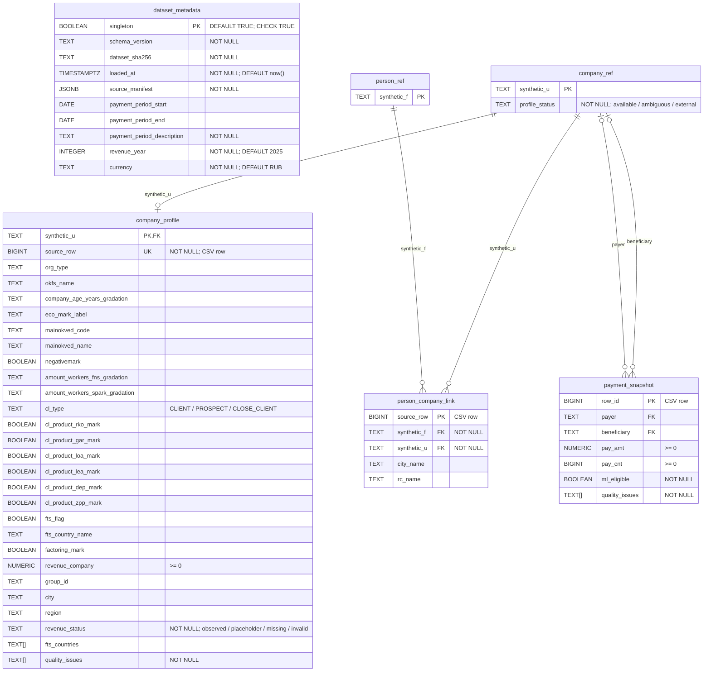

# Диаграмма БД

Источник: [02_tables.sql](../sql/02_tables.sql). Схема `business_insights`, 6 таблиц.

`PK` — первичный ключ, `FK` — внешний ключ, `UK` — уникальность. `NOT NULL` указан в комментариях полей; первичные ключи также обязательны. `TEXT[]` — массив строк.

`dataset_metadata` хранит одну запись о текущем наборе и не связан с другими таблицами внешними ключами. Исходные записи остаются в CSV; `source_row` и `row_id` обозначают номер записи исходного файла без заголовка и не являются внешними ключами.

В `company_profile` выручка заполнена тогда и только тогда, когда `revenue_status = 'observed'`. Для платежей с `ml_eligible = TRUE` обязательны обе стороны, сумма и счётчик. Пара `payer`–`beneficiary` не уникальна. История наборов не реализована.

Дополнительные индексы: `company_profile(group_id)`, `person_company_link(synthetic_u)`, `person_company_link(synthetic_f)`, `payment_snapshot(payer)`, `payment_snapshot(beneficiary)`.
