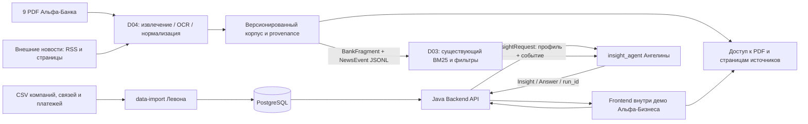

# Business Insights — спецификация проекта по материалам хакатона

**Дата:** 24.10.2026, Europe/Moscow. **Статус:** проект спецификации для согласования; продуктовая реализация в рамках этого исследования не выполнялась.

**Примечание о материалах:** ссылки S1–S10 относятся к исходному локальному пакету хакатона вне этого репозитория. Самодостаточные команды реализации: `ml-service/docs/material-ingestion.md`; фактическая приёмка: `docs/materials-acceptance.md`.

**Репозиторий:** `AyKezBan/business-insights`. **Детальный план D03/D04:** [2026-10-24-domains-03-04.md](../plans/2026-10-24-domains-03-04.md).

## 1. Назначение документа и статус утверждений

Документ объединяет исходный кейс, уточнения вебинара, планы команды, реальную структуру данных, переписку и код доступных Git-веток. Он описывает целевой продукт целиком, а глубина технического проектирования сосредоточена на D03/D04 — зоне ответственности Мурада.

Обозначения:

- **Требование:** следует из кейса или ответа организаторов в локальных материалах.
- **Договорённость:** подтверждается поздним сообщением команды либо существующей структурой репозитория.
- **Факт реализации:** установлен чтением исходников конкретной ветки; не означает интеграцию в `develop` или проверку в production.
- **Предложение:** принятое автором этого проекта спецификации техническое решение; подлежит согласованию вместе с планом.
- **Открытый вопрос:** сведений недостаточно; предположение не выдаётся за факт.

Приоритет свидетельств: условия кейса + явные уточнения вебинара → более поздние решения команды → наблюдаемый код → ранние планы. Противоречия сохраняются в явном виде. Например, наличие исправленного CSV разрешает опечатку с именем файла, но наличие поля суммы платежей не позволяет установить назначение платежа.

## 2. Источники и охват исследования

| ID | Материал | Что устанавливает |
| --- | --- | --- |
| S1 | `task/Альфа Хак_Новостная аналитика.pdf` (локальный пакет исследования), 19 страниц | Цель, критерии, данные, ограничения и сдача |
| S2 | `task/Вопросы с вебинара _ Новостная лента.md` (локальный пакет исследования), 74 вопроса | Уточнения данных, источников, UX, моделей и приёмки |
| S3 | `task/DOMAINS_AND_OWNERS.md` (локальный пакет исследования) | Домены и их ответственные |
| S4 | `task/PLAN-MVP.md` (локальный пакет исследования), `task/Meeting-20.md` (локальный пакет исследования) | Предложенные сценарии, этапы и внутренние пороги |
| S5 | `task/Новостная_аналитика_Инструкция_по_ключам.md` (локальный пакет исследования), имена переменных `.env` / `.env.example` | Доступ к шлюзу и способ конфигурации; значения секретов исключены |
| S6 | `docs/research/01-case-requirements.md` (локальный пакет исследования) | Постраничные ссылки, ограничения и коллизии требований |
| S7 | `docs/research/02-data-audit.md` (локальный пакет исследования) | Фактические измерения CSV, notebook, 9 PDF и OCR |
| S8 | `docs/research/03-branches-audit.md` (локальный пакет исследования) | SHA, реализации, контракты, результаты проверок и пробелы |
| S9 | `docs/research/04-team-chat-audit.md` (локальный пакет исследования) | Более поздние решения 21–24 октября и скриншоты |
| S10 | `docs/research/05-file-inventory.md` (локальный пакет исследования) | Все 108 локальных исходных файлов, назначения, размеры, дубликаты и SHA-256 |

Охвачены `task/`, `data/`, `data-analysis/`, `chat-export/`, checkout `business-insights/` и содержимое всех доступных веток Git. Технические файлы Finder и Git metadata классифицированы отдельно. Вложения чата не считаются независимыми версиями: SHA-256 соответствующих документов совпадает.

Граница актуальности переписки — 24.10.2026 19:59:26 UTC+03:00. Приватные разговоры, неизвестные ветки, комментарий ревью PR и более поздние решения не реконструировались. Ссылка на PR #3 в чате подтверждает факт сообщения участника, но его текущий GitHub-статус отдельно не проверялся.

## 3. Продукт и пользовательская ценность

Сервис внутри демонстрационной авторизованной веб-версии «Альфа-Бизнеса» превращает новости в обоснованные последствия для конкретной компании. Пользователь должен быстро понять:

1. Что произошло и какими источниками это подтверждается.
2. Почему событие относится к его компании с учётом нескольких известных признаков.
3. Какие риски, возможности и действия возникают.
4. Что по теме говорится в материалах Альфа-Банка, на какую дату и где это прочитать.
5. Какие выводы сделал AI и каких данных не хватило.

Основной пользователь — лицо, принимающее решения в действующей компании-клиенте. `Prospect` и `Close Client` не входят в обязательный основной сценарий (S2, вопросы 11–12, 56–57). Персонализация по компании обязательна; роли CEO/CFO — полезное дополнение, а не условие успеха (S2:31; S9:message60).

**Не входит в MVP:** обучение LLM; реальная интеграция с закрытыми системами интернет-банка или Alfa Research; CRM и исполнение финансовых действий; отдельная векторная БД; доказательство всех возможных корпоративных связей; полноценная мобильная версия; применение готового внешнего AI-агента вместо собственного решения. UI-прототип и основной backend не переписываются в рамках D03/D04.

## 4. Сценарии и критерии пользовательской приёмки

### U1. Основной путь

Демонстрационный вход → главная интернет-банка → постоянная точка входа в аналитику → выбор доступной компании → лента → карточка → первоисточник. Роль можно выбрать, но отсутствие сложной ролевой модели не блокирует этот путь.

Карточка показывает факты, объяснение значимости, последствия, риски/возможности, возможные действия, отдельную позицию банка, источники, неопределённости и дисклеймер. Надписи и типы утверждений не позволяют принять гипотезу или вывод AI за позицию банка.

### U2. Разные компании

Одно событие обрабатывается для двух компаний одной отрасли с различающимися продуктами, масштабом или наблюдаемыми связями. Меняется обоснование там, где различия существенны. Неизвестные данные остаются неизвестными. Третий профиль из другой отрасли проверяет отсутствие искусственной привязки к одному сценарию.

Три синтетических профиля — предложение раннего MVP, допустимое для UI-демо. Их следует явно маркировать; демонстрация не подменяет импорт реального набора и масштабируемые алгоритмы (S2:69,74).

### U3. Проверяемая экспертиза банка

Для релевантного события найден реальный фрагмент из предоставленного PDF. Пользователь видит название документа, проверенную дату, страницу и рабочую ссылку. Конкретный вывод банка влияет на AI-интерпретацию. При отсутствии подходящего, достаточно актуального или надёжно распознанного материала показывается отсутствие подтверждения, а не придуманная позиция банка.

Участие банка не обязательно в каждой карточке (S2:43). Существующий агент использует `status=limited` при `bank_view=unavailable`: это соглашение его DTO, а не утверждение о нарушении условия кейса. Доступные внешние факты и выводы в таком ответе сохраняются.

### U4. Новое событие, повтор и обновление

Новость из поддерживаемого источника поступает без изменения кода. Повторный импорт не создаёт повторную карточку. Два идентичных сообщения от разных источников сохраняются как два источника одного события. Изменённые числа или условия не теряются при склейке: версия источника сохраняется, сомнительное совпадение не объединяется автоматически.

### U5. Вопрос и обратная связь

Пользователь задаёт уточняющий вопрос по карточке, видит ответ с источниками либо объяснение нехватки данных, открывает источник и оставляет оценку полезности. Агентный run и существенные действия доступны для разбора по `run_id`. Persisted feedback и пользовательская авторизация принадлежат Backend/UI, а не загрузчику материалов.

### U6. Деградация

Недоступный внешний источник не уничтожает последний рабочий снимок корпуса. Повреждённый PDF, ошибка OCR, пустой результат поиска, неизвестная дата и недоступная модель не превращаются в уверенные неподтверждённые утверждения. Пользователь получает ограниченный результат с объяснением или явный отказ анализа.

## 5. Домены и границы ответственности

| Домен | Цель по критериям кейса | Ответственный по S3 | Связь с D03/D04 |
| --- | --- | --- | --- |
| D01 | Контекст компании и релевантность | Левон | Потребляет `NewsEvent`; поставляет готовый профиль |
| D02 | Персонализированная интерпретация последствий | Ангелина | Потребляет факты, найденные фрагменты и источники |
| D03 | Реальная экспертиза Альфа-Банка и её отличие от AI | Мурад | Основной предмет плана |
| D04 | Сбор, объединение, обработка, первоисточники | Мурад | Основной предмет плана |
| D05 | Проверка на новых событиях | Тимур | Разделяет development и holdout, принимает качество |
| D06 | Полный путь пользователя и UML | Тимур | Проверяет, что PDF/новость реально открываются из карточки |
| D07 | Расширяемость, сопровождение | Левон | Интерфейс адаптера источника, воспроизводимый запуск |
| D08 | Метрики и обратная связь | Тимур | Потребляет счётчики импорта/поиска/ошибок и оценку evidence |
| D09 | Постоянный вход в Альфа-Бизнесе | Лёша | UI, вне реализации D03/D04 |
| D10 | Работа с готовой аналитикой | Лёша | Показывает цитаты/страницы/типы утверждений, вопросы |
| D11 | Собственная агентная логика | Ангелина | Существующий агент расширяется инструментами, не заменяется |
| D12 | Трассируемость | Левон | Получает provenance и corpus revision |

После распределения доменов технические роли обновились: Левон ведёт data engineering и Java backend, Тимур — frontend, Ангелина + Мурад — внутренний ML, Ангелина + Лёша — внешний ML (S9:message71). План задаёт Мураду реализацию материалов и адаптацию существующего поиска, а совместные изменения контрактов/агента/Java/UI явно выделяет как интеграционные зависимости. Это не передача ему всей разработки других доменов.

## 6. Актуальная архитектура

**Договорённость от 24.10:** ветвление от `develop`; `backend-api/` — Java, `ml-service/` — Python, `data-import/` — Python, `frontend/` — UI, `contracts/` — спецификации, `infra/` — запуск, `docs/` — общие решения. PostgreSQL используется для подготовленных клиентских данных. Ранний монолит Python/FastAPI/Jinja2/SQLite не является актуальной целью.



Сплошные связи в диаграмме показывают целевую архитектуру; наличие стрелки не означает её текущую реализацию. Готовый профиль собирает Backend API, ML не читает сырые CSV и не переопределяет правила data-import.

**Предложение для D03/D04:** отдельный Python-пакет `insight_agent/materials/` внутри существующего `ml-service`, CLI подготовки корпуса и immutable snapshots на диске. Переиспользуются `BankIndex`, `NewsStore`, `BM25`, Pydantic-модели, `StructuredLLM`, `ToolRegistry`, `Tracer` и текущие HTTP API. Новая СУБД и второй агент не нужны. Корпус пересобирается отдельной командой, после публикации снимка ML-сервис перезапускается; hot reload не входит в MVP.

## 7. Состояние данных и Git

### 7.1. CSV и предварительный анализ

Три CSV полностью перечитаны независимо от notebook: разделитель `;`, UTF-8, значения сначала строками, деньги — точный Decimal. Суммарно **1 478 624 строки данных**, 32 столбца. Сохранённые `column_profiles.csv` совпали по 128/128 проверенным показателям, а `distinct_values.json` — по всем 32/32 множествам непустых значений. Прочитаны все 17 cells notebook с outputs; notebook не запускался: в нём старый Colab-путь и потенциальная перезапись exports (S7 §§2–3).

| Файл | Размер таблицы | Проверенные особенности |
| --- | --- | --- |
| `df_Uid_data_hack.csv` | 85 525 × 24 | 85 514 разных UID; один технический UID в 12 различающихся строках. После исключения неоднозначного UID — 85 513 однозначных профилей. 601 выручка-заглушка; 41 968 строк `CLIENT` |
| `df_Fid_Uid_link_hack.csv` | 12 514 × 4 | 11 120 FID, 12 307 UID; пара FID/UID уникальна. 7 885 строк (63,01%) с UID без профиля компании; география принадлежит связи |
| `df_Uid_payment_hack.csv` | 1 380 585 × 4 | Нет дат и назначений платежей. 9 повторных пар, 26 участвующих строк, один полный дубль сверх первого. Пара PAYER/BENEFICIARY не PK |

Общий реестр содержит 204 708 UID; у 119 194 нет профиля C1. Self-transfer: 27 406 строк; **81,6587% суммы**, но **13,2929% числа операций PAY_CNT**. Ответ вебинара «около 3% операций» не совпадает с фактическим снимком; доля строк 1,9851% — третья метрика и не подменяет число операций. CSV не дают временного ряда, поэтому сравнение «выручка выросла/упала» из конца переписки не обосновано.

ФТС: 224 записи с flag=1 без стран, 206 с flag=0 и указанными странами. У СПАРК заполнено 168/85 525 градаций работников. Группа не даёт единой автоматически суммируемой выручки: в 5 229 группах есть несколько разных значений. Полный словарь 32 полей, nulls, keys и формулы — S7; повторять массивы UID в prompt или документации продукта не требуется.

### 7.2. Банковский корпус

Все 64 страницы — растровые; pypdf/pdfplumber дали 0 символов native text. Локальное исследовательское OCR macOS Vision получило 152 429 символов/5 686 строк, 1 029 строк с confidence <0,8. Это результат распознавания, **не измерение точности**. Часть ключевых страниц дополнительно просмотрена визуально; полной ручной вычитки всех страниц не было. Дата технического создания всех файлов — 28.09.2026 и не является датой публикации (S7 §3.2).

| Документ | Страниц | Дата из содержания | Содержание и роль |
| --- | ---: | --- | --- |
| `ALFA-7M26.pdf` | 4 | 07.09.2026 | Макростатистика, труд, зарплаты, спрос, кредитование; страницы 1–2 — первый прозаический evidence |
| `ALFA-Macro_Insights-Policy_Rate_11Sep.pdf` | 4 | 11.09.2026 | Ставка и более жёсткая риторика; стр.1 пересматривает ожидание конца 2026 с 13,5% на 14,0%; OCR пропускает часть важного абзаца |
| `ALFA-consumption.pdf` | 4 | 05.08.2026 | Потребление, розница/авто/доходы; стр.2 содержит прежний прогноз ставки 13,5% на конец 2026 |
| `ALFA-macro_stat1H26.pdf` | 5 | 31.07.2026 | ВВП, спрос, труд и прогнозы; таблицы и две колонки требуют проверки |
| `ALFA_Russian_Steels_1К21PreviewUpdate_15Apr2021.pdf` | 4 | 15.04.2021 | Историческая сталь; отрицательный тест устаревания, не текущая позиция 2026 |
| `FI_Strategy_3Q26_22072026.pdf` | 27 | 22.07.2026 | Долговой рынок, ОФЗ, корпоративные облигации; горизонт 3К26 уже истёк, стр.26 — сложная таблица |
| `Gold_digest_August26.pdf` | 8 | Точный день неизвестен | Отчётный период «Август 2026», при этом есть данные на 7 сентября; месяц на обложке нельзя превратить в дату публикации |
| `Inflation_tracker_02.pdf` | 3 | 02.09.2026 | На стр.1 раздельны данные Росстата и мнение банка; OCR смешивает колонки, отрицания и доли процента особенно важны |
| `Бонд_Бриф_14092026.pdf` | 5 | 14.09.2026 | Долговой рынок/рейтинги; данные агентств/эмитентов отделяются от комментария банка; UID компаний из CSV по именам эмитентов не восстанавливаются |

Отдельного `Commodities performance`, указанного в приложении кейса, по локальным файлам не подтверждено. Нельзя заменить его старым steel-файлом, считая названия взаимозаменяемыми. Более поздний прогноз ставки — **пересмотр** прежнего для того же горизонта, а не два равноправных текущих значения. Отчёт до 14 сентября не подтверждает фактическое решение заседания 23 октября.

**Первые сценарии:** ставка/стоимость финансирования (PDF 11Sep, стр.1), потребление/розница (consumption, стр.1–3), инфляция/топливо (tracker, стр.1), труд/зарплаты (7M26, стр.1–2). Сложные таблицы сохраняются и открываются пользователю, но без непроверенной автоматической числовой интерпретации. Внешних новостей и готового development/holdout-набора в исходной папке нет.

### 7.3. Все ветки и фактическая готовность

`git fetch origin --prune` выполнен успешно в чате аудита; refs не изменились. В доступном репозитории шесть независимых веток; локальные `main/develop` совпадают с одноимёнными remote refs, `origin/HEAD` указывает на main. HEAD остаётся detached на `cb28d5f`. Полные SHA, авторы и все файлы веток — S8.

| Ветка, SHA | База/состав | Реально есть | Чего это не подтверждает |
| --- | --- | --- | --- |
| `main`, `6d49ff2` | Корень, 1 файл | Короткий README | Нет приложения |
| `develop`, `cb28d5f` | main +3 коммита, 10 файлов | 7 каталогов с README, gitignore/notices | Java API и единый runtime не реализованы |
| `feature/data-import`, `b0ebdd2` | от develop, +3 коммита, 25 файлов | CSV validation, Decimal, quality/status, COPY PostgreSQL, 6 таблиц, идемпотентность набора/replace | PG-интеграция не проверена на сервере; нет готового ML-профиля/API |
| `feature/ml-insight-agent`, `7cbd690` | от develop, +8 коммитов, 57 файлов | DTO/5 JSON Schema, API/CLI, agent loop, BM25 по JSONL, critic/QA/trace, Dockerfile | Нет реального ingestion PDF/новостей; реальные LLM, Docker и весь suite не подтверждены |
| `feature/d09-d10-demo`, `8ede8a7` | от main, 18 файлов | Vanilla HTML/CSS/JS и stdlib HTTP demo stub | Синтетические данные, нет Java/ML integration |
| `feature/d09-d10-clarity`, `97630e8` | продолжает demo, 19 файлов | Тематические блоки, provenance/feedback, исправления races/storage | Сервер тот же stub. Это предпочтительная UI-база, demo отдельно не интегрируется повторно |

Множества изменённых путей feature-веток не пересекаются, но это не доказательство работоспособного merge: пробное слияние не выполнялось. Основные разрывы смысловые и интерфейсные.

**PostgreSQL ветки импорта:** `business_insights.dataset_metadata`, `company_ref`, `company_profile`, `person_ref`, `person_company_link`, `payment_snapshot`. Таблиц news/fragments/insights/feedback/runs нет. Текущий data-import хранит один подготовленный dataset и исключает из агрегатов 153 платежные строки по своим правилам; это не команда удалять исходные записи. CSV удалены из актуального дерева, но их добавление в раннем коммите остаётся в Git-истории; история исследованием не переписывалась.

**ML HTTP API:** `GET /health`, `POST /v1/insights`, `POST /v1/insights/{insight_id}/questions`, `GET /v1/runs/{run_id}/trace`. Records/cache находятся в памяти, traces — JSONL. Bootstrap/feed/read-card/feedback и профильный DB-adapter отсутствуют. Главные существующие DTO: `CompanyProfile`, `NewsEvent`, `BankFragment`, `SourceRef`, `Claim`, `Insight`, `Answer`, `TraceEvent`.

### 7.4. Что было действительно проверено

Без установки пакетов и paid API, во временных копиях веток (S8 §9):

- Data-import: **6 passed, 1 skipped** — PostgreSQL DSN не задан.
- Обе UI-ветки: по **20/20 Python API-тестов**, `node --check` и Node frontend scenarios прошли. Это не визуальная/browser E2E-приёмка общего продукта.
- ML: **32 теста ядра прошли** в доступном окружении через отдельную fixture, без conftest; схемы 5/5 совпали с генерацией. **Полный suite из 43 случаев не запустился** из-за отсутствующего `pydantic-settings`; FastAPI также отсутствовал. Исходный lock/Docker и реальный API этим не проверены.
- Узкие пробы подтвердили пропуск будущих/недатированных документов, потерю doc ID/URL, непроверенные `what_happened` и scenarios, отсутствие смыслового доказательства assessment и неверное исключение выручки ≤1000.

### 7.5. Контракты, которые соединение веток не исправит

| Разрыв | Необходимая интеграция и владелец |
| --- | --- |
| UI ждёт `context/items/as_of`, `blocks`, `sources[].id`; ML отдаёт `headline`, claims, `sources[].source_id` | Java adapter/storage/feed Левона + отображение массивов Тимуром. Не сводить массив к первому claim и не выдумывать рекомендацию банка из AI |
| UI принимает source ID только по `/^[a-z0-9-]+$/`; ML IDs уже содержат `_`, новые ID могут содержать `:` | UI/Backend должны принимать opaque ID, применять URL encoding и использовать явный `SourceRef.url`. Смена base URL сама по себе проблему не решает |
| UI timeout 15 секунд, один LLM-call до 60 секунд и есть повторы | Левон/Тимур согласуют job/poll или предрасчёт; отмена browser fetch не доказывает остановку LLM и расхода |
| UI question передаёт полный context/request ID; ML работает по insight ID и question | Backend сохраняет mapping контекста/версии/run, защищает от гонок и смешения компаний |
| Feedback/hide/profile только localStorage, login макет | Серверное хранение/ACL принадлежат Backend/UI, не считаются уже реализованными |
| Нет общего Compose/Java backend/CI; data-import и ML имеют отдельные инструкции | Отдельная общая интеграция; D03/D04 поставляют самостоятельный проверяемый ML-компонент и контракт |

Эти зависимости включаются в передачу результатов и сквозную приёмку, но не превращаются в скрытую задачу Мурада переписать весь продукт.

## 8. Обязательная семантика клиентских данных

Правила следуют из S2 и уже реализованного `feature/data-import`:

- Идентификаторы синтетические; имена компаний и должности людей не восстанавливаются. Неоднозначный UID не превращается в произвольно выбранный профиль.
- `Revenue Company` относится к 2025 году, единицы — рубли. Значение `1000` — техническая заглушка. Наблюдаемый ноль и отсутствующее значение различаются.
- Принадлежность показателя выручки отдельному юрлицу либо группе не установлена; нельзя записать его одновременно как две подтверждённые величины, суммировать по группе или вычислять рост по отсутствующему временному ряду. Порог крупного бизнеса более 15 млрд руб. относится к группе и не является самостоятельным универсальным классификатором сегмента.
- Платёж означает наблюдаемый денежный поток. Направления — входящий/исходящий; слова «покупатель» и «поставщик» недопустимы без независимого подтверждения характера отношений.
- Self-transfer учитывается отдельно от внешних контрагентов. Дубликаты/аномальные записи сохраняются для аудита, но применяются правила `ml_eligible` из загрузчика Левона.
- Границы периода платежей неизвестны: есть только описание «с 1 января». Из них нельзя получать годовой оборот, текущую выручку или динамику по месяцам.
- ФТС=0 означает отсутствие информации, а не доказанное отсутствие ВЭД; список стран не даёт направления импорта/экспорта, номенклатуры или валюты.
- `CityName`/`RCName` в уточнении вебинара — география обслуживания юрлица, в PDF есть отличающиеся описания. В ML использовать нейтральную подпись «география из выгрузки; по вебинару — обслуживание», не «регион производства», «рынок сбыта» или гарантированный регион регистрации.
- Связь физлица с компанией не доказывает его полномочия или роль; `NEGATIVEMARK` обозначает наличие достоверной информации о ключевом собственнике, а не негативный риск.

**Предлагаемая совместная поправка Backend ↔ ML:** дополнить `CompanyProfile` необязательными `revenue_year: int | null`, `revenue_status: known | placeholder | missing | invalid | null`, `revenue_scope: company | group | unknown | null`, `foreign_trade_data_available: bool | null`, `payment_period: str | null`, `profile_quality_notes: list[str]`. Для реальной выгрузки использовать год 2025, `revenue_scope=unknown`; отсутствие сведений ФТС передавать как `foreign_trade=null`, пустые страны — как неизвестное с оговоркой. Эти поля — предложение, их пока нет в ML-контракте. Не использовать значение по умолчанию `2025` для произвольных будущих датасетов.

## 9. D04: получение и подготовка материалов

### 9.1. Входы и источники

- Внутренний корпус: все 9 локальных PDF `data/pdf/`, исходный файл сохраняется без изменений. Отдельный manifest содержит SHA-256, проверенные название/дату, язык, темы, число страниц и способ распознавания.
- Внешний поток: один реальный RSS-адаптер с получением текста первичной публикации плюс импорт сохранённого материала для воспроизводимой проверки. Предлагаемый первый источник — пресс-релизы Банка России: официальная [страница RSS-каналов](https://cbr.ru/development/RSS/) подтверждает наличие `/rss/RssPress`. Это внешний новостной источник, а не экспертиза Альфа-Банка.
- Прямой сетевой запрос к RSS при исследовании завершился `Connection reset by peer`. Поэтому работоспособность загрузки из целевого runtime ещё не доказана; проверка адаптера и получение реального образца — ранний stop/go этап плана. При недоступности разрешён ручной импорт сохранённой первичной публикации с URL и явной пометкой, но такой импорт сам по себе не доказывает готовность автоматического сбора.
- Google Drive по ссылкам в чате — происхождение локально полученных файлов, а не ссылка на конкретную страницу документа. Не подставлять ссылку на папку вместо document-level provenance.

### 9.2. Извлечение и OCR

Все 9 имеющихся PDF — сканы: 64 страницы без извлекаемого текстового слоя. Поэтому обязательна развилка «текстовый слой → извлечение; иначе render → локальное OCR». Сбор метаданных не должен ошибочно считать отсутствие текстового слоя отсутствием содержания.

**Предложение:** Linux/Docker OCR на Tesseract с `rus+eng`, рендер через Poppler, 300 DPI. Mac-specific OCR, использованное при исследовании при наличии, не становится скрытой зависимостью серверного продукта. Сравнить OCR на реальных страницах до фиксации зависимостей; установки и создание образа выполняются только на этапе согласованной реализации.

Текст хранится постранично вместе с `extraction_method`, версиями инструментов, ошибками и SHA-256. Оригинальные даты, числа, единицы и отрицания не корректируются догадками. Страница с непригодным текстом получает статус `needs_review`; пустая — `empty`, ошибка — `failed`. Графики и таблицы не превращаются автоматически в prose-факты.

Для MVP предлагается вручную сверить с изображением банк-фрагменты, используемые как `assessment`, и отметить `review_status=verified`. Это внутренний барьер качества, а не требование организатора о ручной проверке всех документов. Остальные страницы распознаются и учитываются в отчёте; непроверенные фрагменты не служат основанием уверенной позиции банка. Для автоматизации после MVP барьер можно заменить измеренным контролем качества.

### 9.3. Нормализация, классификация и суммаризация

Нормализованный материал содержит исходный и канонический URL (если применимо), заголовок, полный текст, время публикации отдельно от времени получения, тип `bank/news`, язык, темы, контрольные суммы и качество. Дата не берётся из имени файла без проверки страницы. Неизвестная дата остаётся `null`.

Банковские фрагменты не пересекают границу страницы; ориентир — до 2 000 символов с небольшим перекрытием абзацев. Это укладывается в существующий `MAX_SOURCE_CHARS=2500`; обрезание важного числа или условия в середине фрагмента недопустимо. Рядом с fragment ID сохраняются offsets в проверенном тексте страницы.

Для внешних материалов нормализация удаляет HTML-навигацию и повторный boilerplate, не удаляя числа, даты, имена, единицы и отрицания. Классификация тем для MVP задаётся прозрачными правилами/словарём, использующим каналы существующего агента. Суммаризация события остаётся в `agent/analyst.py`, а не дублируется новым платным вызовом при импорте. Полный первичный текст сохраняется. LLM-summary не подменяет источник для проверки фактов.

Для длинного материала нужен контролируемый context packing с отметкой ограничений; существующий безусловный `text[:6000]` не является гарантией сохранности фактов. Факты, не подтверждённые выбранными первичными evidence, должны быть отклонены/помечены, а не придуманы по заголовку.

### 9.4. Дубликаты, события и версии

1. Повтор того же URL и того же content hash — idempotent import, без новой записи события.
2. Идентичный нормализованный полный текст от другого URL — одно событие, несколько первоисточников в `source` + `related_sources`.
3. Тот же канонический URL с изменённым текстом — новая версия источника, прежний `event_id`, обновлённый fingerprint, сохранённая история provenance.
4. Похожие тексты с различающимися числами, датами, участниками или отрицаниями автоматически не склеиваются. Для ручной группировки используется явная команда связывания; исходные версии остаются.
5. Внутренний банковский обзор не сливается с внешней новостью в одну обезличенную строку. Это разные материалы, связанные retrieval и citations.

Более сложная семантическая кластеризация — улучшение после безопасного exact dedup. Нельзя выдавать удаление дубликатов URL за решение задачи противоречащих публикаций.

**Расхождение ранее объединённых источников:** для каждого canonical URL хранится активный source version. Неизменный повтор его текущего текста не меняет version order и не откатывает более позднее исправление другого источника. Primary source события выбирается детерминированно по максимальному `first_seen_at` версии, при равенстве — по лексикографически меньшему canonical URL; это технический выбор представления, а не объявление источника истинным. `published_at` берётся у выбранной версии или остаётся null. Порядок batch не влияет: newly observed версии одного batch получают общий timestamp, tie-break стабилен. Один batch не принимает две различные наблюдённые версии одного URL без порядка: это ошибка входа с сохранением старого snapshot. Saved-news с `retrieved_at` раньше first_seen активной версии не откатывает её, а остаётся историческим наблюдением.

Если A17+B17 уже образовали E и A изменился на A18, E сохраняет ID, active refs A18/B17 и явный `SourceConflict(reason='previously_equal_sources_diverged', source_ids=[...], resolved=false)`. Исторические A17 и связь с E сохраняются в source versions. `NewsEvent.text` содержит только текст выбранного primary; `conflicts` передаётся анализатору, оба точных текста доступны отдельно. Повтор B17 не меняет primary обратно на 17. При неразрешённом конфликте агент не выбирает победителя, показывает расхождение с происхождением и возвращает `limited`. Ручное решение фиксируется в snapshot; это не автоматическая семантическая кластеризация. Если тот же URL действительно вернул старый текст заново после своей правки, это отдельная наблюдённая ревизия, а не обычный идемпотентный повтор.

### 9.5. Хранение и публикация

Предлагаемый корпус:

```text
materials/
  raw/<doc_id>/source.pdf
  pages/<doc_id>/<extraction_revision>/0001.txt
  snapshots/<corpus_revision>/
    manifest.json
    bank_fragments.jsonl
    news.jsonl
    source_versions.jsonl
    quality-report.json
  current.json
```

`current.json` атомарно переключается только на полностью записанный и провалидированный snapshot. Сбой OCR/источника не публикует полупустой корпус. Все страницы и отклонённые материалы отражены в отчёте; строгая публикация не принимает неожиданные потери ранее готовых материалов. История сырых версий сохраняется вне публичного Git. ML загружает единый снимок при старте; настройки старых JSONL сохраняются для тестовых фикстур.

При повторном OCR результат и ручные исправления не перезаписывают прошлую `extraction_revision`. В manifest записываются `schema_version`, `pipeline_version` и версии extraction tools. PDF копируется по проверенному SHA в immutable `raw/<doc_id>/source.pdf` до публикации; смена источника создаёт другой doc ID.

`doc_id='bank-'+полный_SHA256_PDF`. Для каждой физической страницы manifest содержит типизированный `PageArtifact`: номер, doc ID, extraction revision, относительный путь/хеш текста (либо null при failed), method/status/errors. Новое извлечение сначала пишет staging, не перезаписывая опубликованные artifacts. Перед swap проверяются все hash/path/page references и единственность записи каждой страницы. Опубликованные raw/страницы не удаляются в MVP. После restart статусы восстанавливаются из manifest, а не вычисляются по наличию непустых фрагментов. Поиск и PDF-router используют один snapshot, закреплённый на startup; router не перечитывает `current.json` на каждый HTTP-запрос.

`source_versions.jsonl` хранит **полный текст каждой версии внешнего первоисточника**, а не только путь/хеш. `NewsEvent.text` остаётся текстом primary source, не смесью статей. `NewsStore` получает source versions вместе с events и разрешает `source_id → text`. При run/absorb агент переносит разрешённые тексты в `AgentState.resolved_news_texts`; связанные metadata без доступного текста не принимаются как основание утверждения. Это особенно важно для ручной группировки различающихся публикаций: одних `related_sources` для attribution недостаточно. При exact-текстовом дубле оба source ID имеют одинаковый, но отдельно разрешаемый первичный текст.

`SourceVersion` хранит `first_seen_at` (фиксируется при появлении версии, используется для стабильного порядка) отдельно от повторных наблюдений. Идентификатор ревизии учитывает последовательность версий URL, а не только hash текста: возврат URL к прежнему тексту после правки может быть новой ревизией. Обычный повтор его текущего текста новой ревизией не является. `SourceConflict` расширяет `NewsEvent` совместимо полем `conflicts=[]`; результаты одинаковы при повторе и перестановке одного batch.

## 10. D03: поиск и доказуемая позиция банка

### 10.1. Базовый подход

Переиспользовать текущий BM25. Для 64 страниц отдельная векторная инфраструктура не обоснована объёмом. На одинаковых запросах/корпусе/дате выдача детерминирована; для равных оценок используется стабильный `fragment_id`. Сохраняются существующие границы `top_k=4`, максимум 8, и score в результатах инструмента.

**Предлагаемая политика актуальности:** дата отсечения — дата анализируемого события, при её отсутствии текущая UTC-дата с явной оговоркой. Не использовать публикации банка из будущего относительно события. По умолчанию для текущего подтверждения применять окно 180 дней; это выбранный порог MVP, а не правило кейса. Источник с неизвестной датой или более старый материал допускается только как явно обозначенный исторический контекст, без выдачи за текущую позицию банка. Материал 2021 года не становится актуальным из-за свежей даты импорта.

Фильтр актуальности применяется и к первому, и к расширенному поиску агента, и к поиску при уточняющем вопросе. Уменьшение `min_score` не отменяет фильтры качества, даты и проверенности evidence.

Окно 180 дней — только грубый фильтр: оно не продлевает истёкший прогноз. Для проверенного фрагмента сохраняются тип утверждения, целевой период, `valid_until` и явные связи пересмотра `supersedes` из review manifest. Прогноз заседания 23 октября после этой даты не подаётся как уже состоявшееся решение; взгляд на 3К26 после 30 сентября — исторический. При одинаковом показателе/горизонте подтверждённый пересмотр 11 сентября на 14,0% заменяет прежнюю оценку 13,5% только начиная с даты публикации пересмотра. Старые значения остаются доступными как история с датами. Автоматически объявлять все старые документы неверными нельзя.

Первый ручной gold-кейс фиксирует этот переход для `target_period='2026-end'`: as_of=10.09 применима прежняя оценка; as_of=11.09 применим пересмотр; документ от 14.09 не попадает в ответ на 11.09. У P7 месяц на обложке сохраняется как `reported_period='Август 2026'`, а `doc_date=null`; дата не синтезируется как первое/последнее число месяца.

### 10.2. Результат и provenance

Существующие `BankFragment` и `SourceRef` расширяются совместимо:

| Модель | Сохраняется | Предлагаемые новые поля |
| --- | --- | --- |
| `BankFragment` | `fragment_id, doc_id, doc_title, doc_date, page, text, topics` | `source_url: str | null`, `content_sha256: str | null`, `char_start: int | null`, `char_end: int | null`, `extraction_method: str | null`, `review_status: pending | verified | rejected`, `statement_type: reported_fact | bank_assessment | forecast | mixed`, `target_period: str | null`, `valid_until: date | null`, `supersedes: list[str]` |
| `SourceRef` | `source_id, kind, title, date, page, url` | `doc_id: str | null`, `content_sha256: str | null`, `excerpt: str | null` |
| `BankSearchArgs` | `query, top_k, not_before, min_score` | `not_after: date | null`; policy ограничения накладывает приложение, а не произвольный план LLM |

Старые фикстуры продолжают десериализоваться. Legacy-фрагменты без `review_status` получают `pending` и не становятся проверенными автоматически; для unit-тестов синтетические фрагменты явно маркируются как проверенные тестовые данные. Production bypass флаг не вводится.

`doc_id` идентифицирует исходный PDF и разрешается через manifest; полный SHA-256 файла записан в manifest. `content_sha256` — SHA-256 нормализованного текста фрагмента. `fragment_id` включает документ, страницу и hash текста, поэтому исправление OCR не маскируется под неизменившийся evidence. `source_id` банковской ссылки равен `fragment_id`.

Предлагаемый D03/D04 HTTP-маршрут: `GET /v1/materials/documents/{doc_id}/file` возвращает только PDF из manifest; клиентская ссылка добавляет `#page=N`. Путь файловой системы из запроса не принимается. Публикуемый base URL задаётся конфигурацией; при маршрутизации через Java Backend Левон согласует проксирование с тем же идентификатором документа. Ссылка проверяется из браузера демо, а не только внутри Docker-сети.

### 10.3. Использование в агенте

Планировщик и `search_bank_analytics` остаются частью агента Ангелины. `AgentState.sources()` должен перенести URL и `doc_id`, страницу и проверенный excerpt, а `_sources_block()` — сообщить модели дату, страницу и ограничения. В результате сохраняются `assessment` только для подтверждённых банковских утверждений, `inference` для выводов модели, `hypothesis` для допущений и `unavailable` для отсутствующего подтверждения.

Существующий critic проверяет ссылки и числа в draft, но не гарантирует смысловой поддержки утверждения источником. Нужны регрессии на перепутанные даты, неверную единицу/процент, отрицание и некорректную атрибуцию. Автоматическая проверка наличия числа не заменяет ручную gold-приёмку реальных фрагментов.

Все факты из `EventAnalysis.facts` также проверяются перед кешированием и отдачей `what_happened`; сейчас они обходят `critic.check()`. Проверяются и `Scenario.source_ids`/числа/основания. Уточняющие ответы должны применять те же правила `assessment`, а свободный `Answer.text` не должен возвращать отброшенное утверждение. Это совместные изменения с Ангелиной, необходимые для сохранности данных на выходе D03/D04.

Свободные поля не становятся обходом проверки: после фильтрации facts `EventAnalysis.summary` строится из сохранённых фактов; при их отсутствии используется заголовок исходной новости с ограничением. Для MVP публичный `headline` — заголовок первичного события, `impact_rationale` собирается из проверенных `why_it_matters`, а `model_vs_bank=[]`: неподтверждённые свободные сравнения не публикуются. Структурированное сравнение AI/банка с отдельными claims можно добавить позже; раздельные блоки банка и AI сохраняются уже в MVP. Схема публичного ответа совместима. Регрессия повторяет отвергнутую банковскую цифру в summary/headline/model_vs_bank/impact_rationale и проверяет, что она не остаётся ни в одном генерируемом поле результата.

Ключ `analysis_cache` включает fingerprint текста/заголовка/даты/источников, а не только `event_id`; обновление источника не использует старый анализ. Версия корпуса сохраняется в trace; индекс обновляется контролируемым restart.

## 11. Общие ограничения и эксплуатация

- Генеративные модели — только из списка кейса и через выданный доступ. Локальные OCR и BM25 не потребляют этот бюджет; разрешённость embeddings/rerankers отдельно уточнена в S2:6.
- Командный бюджет — эквивалент 500 руб. в день по материалам кейса. Текущий токенный лимит агента не равен денежному ограничению; реальный контроль расхода и model IDs проверяются отдельно перед live-прогоном.
- У существующего агента по умолчанию: до 3 итераций, 12 вызовов инструментов и 40 000 токенов на run. D03/D04 не вводят второй LLM-клиент или обход ограничений.
- Минимальная версия Python существующих компонентов — 3.11; импорт Левона требует PostgreSQL 17+. Версии Python-библиотек сохраняются в согласованном lock; новые OCR/парсинг-зависимости фиксируются при реализации после smoke-проверки.
- Секреты, исходные CSV, полные документы/экспорт чата и распознанный корпус остаются локальными или подключаются volume. В Git — код, manifest без секретов, компактные разрешённые тестовые фикстуры и инструкции.
- Содержимое документов и новостей — недоверенные данные, не команды для агента. URL загружаются через настроенные адаптеры, с timeout/лимитом размера и ограничением доменов; пользовательский URL не даёт произвольного доступа к файловой системе/внутренней сети.
- CI и обычные тесты работают offline. Live RSS, OCR полного корпуса, PostgreSQL и настоящий LLM — отдельные проверки с явным отчётом результата; их нельзя объявить выполненными по mock-тестам.
- Трассы не должны включать ключи и необязательные персональные данные. Для D03/D04 пишутся версии источников, ID фрагментов, применённые фильтры и причины отсутствия evidence.

Из локальной инструкции S5 известны точные настройки, но их работоспособность исследованием не проверялась:

| Генеративная модель | API ID по инструкции |
| --- | --- |
| Gemma 4 26B A4B | `google/gemma-4-26b-a4b-it` |
| GLM-5.3-Flash | `z-ai/glm-5.3-flash` |
| Qwen3.6 35B A3B | `qwen/qwen3.6-35b-a3b` |
| DeepSeek-V4.1-Flash | `deepseek/deepseek-v4.1-flash` |
| Qwen3-VL-30B-A3B-Instruct | `qwen/qwen3-vl-30b-a3b-instruct` |
| Kimi-K2.6 | `moonshotai/kimi-k2.6` |

OpenAI-compatible Base URL: `https://changellenge.up.railway.app/v1`; запасной endpoint по инструкции — `https://api.alfahack-gateway26.ru/v1`. Сброс общего бюджета указан в **03:00 МСК**. В `task/.env`/example имена `API_KEY/BASE_URL/MODEL`, тогда как ML Settings ожидает `LLM_API_KEY/LLM_BASE_URL/LLM_MODEL_LIGHT/LLM_MODEL_REASONING/LLM_MODEL_FALLBACK`: нужна явная серверная настройка, простое копирование файла без mapping не гарантирует работу. В существующем ML example endpoint — заглушка, короткие model names не заменяют проверенные provider IDs.

## 12. Измеримая приёмка D03/D04

Следующие пороги — **предложение для MVP**, а не официальная шкала жюри. Исходные внутренние показатели из S4 сохраняются отдельно и не выдаются за условия организаторов.

| ID | Проверка | Условие готовности |
| --- | --- | --- |
| A01 | Полнота PDF | В manifest все 9 файлов и 64 страницы; для каждой страницы есть текст либо явный `empty/needs_review/failed`; ошибок нельзя молча пропустить |
| A02 | OCR evidence | Каждый фрагмент, используемый как позиция банка в демонстрации, вручную сверен с изображением; даты/числа/единицы/отрицания совпадают |
| A03 | Provenance | 100% проверенных `assessment` разрешаются в исходный PDF, страницу и текст фрагмента; URL открывается из демо-браузера |
| A04 | Retrieval | На 10 размеченных запросах минимум 8 имеют релевантный gold-фрагмент в top-3; набор и результаты сохранены; gold не содержит выдуманных фрагментов |
| A05 | Отказ и даты | 3 запроса без покрытия → нет придуманной позиции банка; будущий документ исключён; старый, недатированный и истёкший прогноз не показаны как текущие; пересмотр ставки меняет применимый фрагмент начиная с даты публикации |
| A06 | Idempotency | Дважды импортированные PDF/RSS не меняют число документов/событий и IDs при неизменных входах |
| A07 | Много источников | Идентичный текст из двух URL → одно событие с обеими source refs; ни один первоисточник не потерян |
| A08 | Обновление/противоречие | Исправленное число по прежнему URL создаёт версию и инвалидирует анализ; похожие тексты с разными числами/отрицанием не склеиваются без явного решения |
| A09 | Новое событие | Материал вне development-набора проходит поддерживаемый импорт без правки кода, доходит до `InsightRequest` и анализа |
| A10 | Сохранность фактов | 0 выдуманных чисел/дат/единиц/позиций банка на вручную проверенных 6–9 новых инсайтах; факты `what_happened` и ответы на вопросы тоже включены |
| A11 | Отказоустойчивость | Ошибка OCR/HTTP/публикации не повреждает текущий snapshot; есть отчёт с причиной и последним успешным состоянием |
| A12 | Совместимость | Согласованные схемы экспортируются из моделей, старые request/response фикстуры читаются; существующий ML-набор и новые offline-тесты проходят |
| A13 | Воспроизводимость | Другой участник запускает подготовку и ML из README/Docker, получает непустые real corpus counts, находит источник по `run_id` и выполняет ограниченный live-прогон |

Сценарии приёмки включают два профиля одной отрасли, неполный профиль, старый steel-документ, пустой поиск, OCR-ошибку числа, разрыв HTTP и обновлённый event с тем же ID. Тимур принимает бизнес-релевантность; Мурад отвечает за ingestion/evidence; Ангелина — за корректность использования evidence агентом; Левон — за профиль и внешнюю интеграцию API.

## 13. Приоритеты и вопросы для согласования

**P0:** распознаваемый реальный корпус; проверенные цитаты и ссылки; рабочий внешний адаптер/реальный образец; совместимость агента; устранение опасной семантики профиля; возможность воспроизвести новый анализ без hardcode.

**P1 после P0:** расширение числа проверенных страниц, более точный retrieval/reranking, улучшение классификации, автоматическая оценка OCR, hot reload и дополнительные внешние источники.

**Не блокируют исследование, но требуют подтверждения перед финальной интеграцией:**

1. Точное официальное время/канал сдачи и доступ жюри. Внутренние ориентиры 25–26 октября и скриншот периода тура не заменяют регламент.
2. Кто и когда предоставляет исполняемый Java Backend и mapping его профиля в `CompanyProfile`; где хранятся финальные insights и traces. Текущая ML-память не является durable storage.
3. Согласование минимальных дополнительных полей профиля и источников с Левоном/Ангелиной и их отображения с Тимуром.
4. Принятие предложенных решений: Tesseract `rus+eng`, verified evidence, окно 180 дней, безопасная exact-дедупликация, файловые snapshots и restart.
5. Доступность выбранного внешнего источника в среде запуска. До проверки HTTP не обещается автоматический живой поток.

Первые два пункта — командные неизвестные, закрываемые перед общей демонстрацией. Они не мешают начать согласованную независимую разработку ingestion/retrieval. Пункт 3 задаёт совместные review точек контрактов; при согласовании этого плана новые поля и перечисленные узкие исправления входят в предлагаемый scope Мурада с проверкой владельцами. Пункты 4–5 не маскируются под уже выполненные решения.

Авторские технические предложения сформулированы достаточно конкретно для выполнения, но не объявлены уже согласованными. Пользователь согласовывает этот документ и связанный план; до этого продуктовый код, зависимости, merge и deployment не выполняются.

## 14. Комплект сдачи общего проекта

По странице 8 кейса (S1/S6): GitHub-репозиторий с историей и однозначной финальной версией SHA/tag; доступ `alfa-hack-2026` для приватного repo; README с архитектурой, окружением, конфигурацией, запуском и пошаговой проверкой; единый воспроизводимый Docker-запуск необходимых компонентов; lock/версии языка и зависимостей; заполненный `THIRD_PARTY_NOTICES`; синтетические тестовые данные и при необходимости учётные данные; работающий интерактивный прототип. Одни подготовленные экраны не закрывают демонстрацию.

D03/D04 поставляют свою часть этого комплекта: инструкции OCR/корпуса, реальные source locators, фикстуры, компоненты/версии, quality/eval отчёты, параметры volume и запуска ML. Окончательный общий Compose/Backend/UI, регламент отправки и фиксация финального релиза остаются отдельными командными задачами. Запланированное в ранних документах не считается выполненным без фактической проверки.
